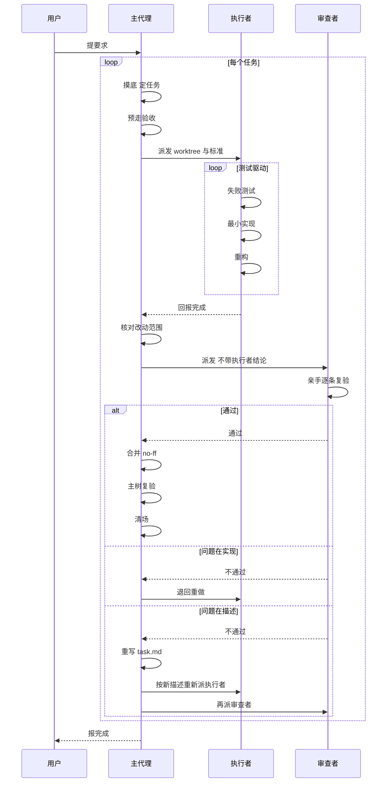

# 编程流程

一份纯流程契约，给两种人用：**人类开发者**（提要求、做裁决）和**具备子代理能力的 agent 软件**（照着它干活）。目的是让 agent 软件开发时**更有效率**——不是让它留更多的记录。更根本的目标是**降低人类开发者的决策成本**：能自己判断的自己判断，能自己收拾的自己收拾，人只在真正需要裁决的地方出现。

这套流程**按任务收费，和改动大小无关**：一个任务至少要预走一遍验收标准、派执行者与审查者各一个独立子代理、建一个 worktree、留四个文件、跑一次合并后复验。小到一个 agent 几分钟能写完、自己一眼能验完的活，不要用它——成本大于收益。

它规定主代理、执行子代理、审查子代理怎么协作，什么算完成，什么不算。它不规定用什么模型、什么子代理机制、什么编程语言，也不附带任何脚本；Git 是唯一被指定的工具。

## 硬前提

**宿主必须能派发具备独立上下文的子代理，并且能读写项目文件、运行命令（含项目的验收测试）、使用 Git worktree。**

独立上下文的判据（它约束的是审查者）：审查者能看到的东西，全部来自派发时传给它的材料、和它被指到的那棵 worktree；它读不到主代理与执行者的对话历史。审查者还必须**能跑命令、能写 `.pipeline/reviewer.md`**——只能读、不能动的审查者等于没有审查。

做不到上面这些，本技能不适用——**不要自己给自己降级**：不要让同一个上下文既实现又审查。没有独立审查，这套流程剩下的部分全部失去意义。

## 角色

- **主代理**：面向用户，决定做什么、以及什么算完成。规划、写任务描述、派发子代理、核对结果、合并。**自己不改产品代码**（合并、跑验收命令、撤销整次合并的 `git revert -m 1`、补提交 `.gitignore`、补写公共 gitdir 的 `info/exclude` 条目都不算改代码）。**它负责把流程推到底**：停不停、报不报完成，按第 11 条办。
- **执行子代理**：在隔离 worktree 中实现一个任务，遵循测试驱动：先写失败的测试，再写最小实现，然后重构。不动任务描述里的验收标准；标准有问题就报回来，不自行改。
- **审查子代理**：在独立上下文中亲手复验，不采信任何转述，只看代码、测试，和自己跑出来的结果。它不提交任何东西，也不替执行者改代码——复验中为了动手验证而临时动过的东西留在工作区不进提交，还原按「临时文件」一节办。
（摸底和会刷屏的活都可以派**一次性子代理**——见「噪声」。**它不是这里列的角色**：不建 worktree、不写 `.pipeline/`、不动产品代码，回到主代理的只有一份结论。）

## 噪声

主代理的上下文用来做决定，不用来通读原始输出。

动手之前先预判：这一步会刷出多少原始输出。按输出性质选处理方式：

- **短输出或结果即结论**：直接保留完整输出。文件读取、小范围搜索、`git status`、`git diff`、版本号、路径和产物检查都属于这一类；输出本身是要判断的结果，不能因为它可能变长就随意隐藏——确实变长的，仍按长输出命令存日志、摘要进来、按需回查，「不隐藏」指要看到能下判断的内容，不是全文必须进上下文。
- **长输出命令**：完整 stdout/stderr 必须保存到系统临时目录；进入当前上下文的是执行摘要和有限预览，不是完整原始输出。摘要至少包含退出码、是否超时、耗时、输出规模、临时日志路径，以及输出的头部、尾部和可机械识别的错误/失败/警告片段。摘要由执行工具或确定性脚本生成，不要求调用 LLM；宿主不支持自动摘要时，由 agent 主动写临时日志并按需读取。
- **探索性噪声**：全仓搜索、翻目录、追一条跨很多文件的调用链，以及不需要主代理亲自持有原始输出的摸底，可以派一次性子代理。它只回传能直接决定下一步的结论，不回传过程或原始输出。

完整日志是可回查的事实，不是摘要的替代品。摘要不足以判断时，读取日志中的相关范围；失败时优先查 stderr、错误/失败片段及其上下文，仍不能判断再扩大范围或重新执行更窄、机器可读的命令。

- **噪声止于一次性子代理或摘要**。主代理不通读与当前决定无关的原始输出；但执行者、审查者和主代理亲自执行的关键验收命令，必须保留完整长输出到可回查的临时日志——宿主存不下时按第 5 条（`degraded` 与 `missingFields`）办。
- **答案的形状在派发时就定死**。摸底确定的那四件事（见第 1 步「读项目约定」）就是这个形状；答不上来的，直接说答不上来。
- **决定权不跟着派出去**。一次性子代理没有用户通道，遇到需要产品决策的，把情况如实回报给主代理；由主代理按第 9 条问用户。
- **它的结论是规划材料，不是证据**。凡要当判据的事实，由主代理亲手走一遍或由审查者复验；必须主代理亲手做的动作（走验收、合并、主树复验）要保留命令、退出码、执行摘要和必要的后置验证，不要求把完整输出全部放进主代理上下文。

## 执行结果结构

执行层（宿主侧的命令执行设施）向 agent 返回**统一的通用外壳**，不试图统一不同命令的业务语义。长输出命令的完整 stdout/stderr 保存在系统临时目录；返回给 agent 的 `preview` 是有限预览，不能代替原始日志。所有字段都保留，未知值使用 `null` 或空数组，不省略字段。

结构固定如下：

```json
{
  "command": "<命令>",
  "cwd": "<工作目录>",
  "status": "completed",
  "exitCode": 0,
  "timedOut": false,
  "durationMs": 18420,
  "error": null,
  "degraded": false,
  "missingFields": [],
  "stdout": {
    "bytes": 1200,
    "lines": 24,
    "previewTruncated": false,
    "preview": "<有限预览>",
    "logAvailable": true,
    "logPath": "<完整 stdout 日志路径>"
  },
  "stderr": {
    "bytes": 8000,
    "lines": 160,
    "previewTruncated": true,
    "preview": "<有限预览>",
    "logAvailable": true,
    "logPath": "<完整 stderr 日志路径>"
  },
  "postcondition": {
    "checked": false,
    "passed": null,
    "summary": null
  }
}
```

字段含义和约束固定如下：

- `status` 使用 `completed`、`failed`、`timed_out`、`failed_to_start` 或 `terminated`。先判断是否超时：超时使用 `timed_out`，即使之后进程被终止也不使用 `terminated`；未启动成功使用 `failed_to_start`；启动后正常退出时，`exitCode === 0` 使用 `completed`，其他整数退出码使用 `failed`；启动后被外部终止且没有退出码时使用 `terminated`，被终止但拿到了整数退出码的按 `failed` 记并在 `error` 写明是被终止的。除 `completed` 和 `failed` 外，`exitCode` 必须为 `null`，并在 `error` 写明原因。`timedOut` 仅在 `status` 为 `timed_out` 时为 `true`。
- `durationMs` 是从执行开始到进程结束、超时或启动失败的毫秒数。`bytes` 按原始输出字节统计；`lines` 按换行符数量统计，若非空输出没有末尾换行则再加一。
- `previewTruncated` 只描述返回给 agent 的预览；`logAvailable` 与 `logPath` 必须保持一致：可回查时为 `true` 和路径，否则为 `false` 和 `null`。长输出命令必须使两路完整日志均可回查；宿主无法做到时将 `degraded` 设为 `true`，把缺失项以 JSON Pointer 字符串（例如 `/stdout/logPath`）写入 `missingFields`，不得宣称满足完整协议。
- `postcondition.checked` 为 `false` 时，`postcondition.passed` 和 `postcondition.summary` 必须为 `null`，表示尚未验证；为 `true` 时，`passed` 必须是布尔值，`summary` 写明验证结论。它由 agent 按验收标准填进执行结果（执行层支持回填就回填进结构，不支持的记进执行摘要或该角色自己的 `.pipeline/` 文件），执行层不能猜测。

测试数量、失败用例、构建产物和迁移状态由测试工具的机器可读输出、项目适配器或明确的后置验证提供；不能从通用 `preview` 或退出码推断出来。宿主按以下顺序适配：

1. 宿主已有结构化命令执行器时，使用它并映射到本结构。
2. 宿主没有现成执行器但能运行脚本时，用宿主可用的 shell（Bash、PowerShell、sh 等）在系统临时目录生成包装脚本，捕获完整 stdout/stderr 并输出本结构；脚本用完即删。
3. 只能直接执行命令时，尽量保存长输出、按上述规则记录可获得的字段并标记缺失（`degraded` 与 `missingFields`）；关键验收必须改用更窄或机器可读的命令，或换能完整保存日志的环境重跑——不能靠一份存不下的日志过关（同第 5 条）。

`执行结果`是固定结构；`执行摘要`只是从它生成、用于节省上下文的有限视图。任何一层都不能用 `postcondition.passed` 代替实际验证。

## 临时文件

**临时文件放在系统临时目录里（`%TEMP%`、`/tmp` 这类），不放进项目。**

- **谁写的都算。** 临时文件是那种用完就该丢、本来不该留在仓库里的东西：为跑一次命令写的脚本、下载下来的数据或工具、跑测试时生成的输入、中间产物——主代理、执行者、审查者、一次性子代理，谁写的都一样。
- **放进项目就不算临时。** 项目里不建 `.tmp/` 这类目录——执行者的 `git add -A` 会把它捡进提交，主树里也会多出与任务无关的文件。
- **要留在仓库里的不在此列。** 交付物、测试代码，和测试要用的夹具与样例数据，照旧进项目；`.pipeline/` 里那四个文件也一样，它们就该待在 worktree 里（见「`.pipeline/`」一节）。每个进不进提交的新文件都先在任务描述（`task.md` 上段）里写明：进提交、执行者把它提进分支，会被第 5 步「改动是否只落在任务描述的范围里」的核对看见；不进提交，把它的路径记进 `task.md` 上段，并写进公共 gitdir 的 `info/exclude`——即 `git rev-parse --git-common-dir` 所指的主仓 `.git/info/exclude`（公共条目对所有 worktree 与主树同时生效；私有 gitdir 的 `info/exclude` Git 不读，别写）。记进 `task.md` 是清场回收这些条目的唯一依据；条目生效期间对主树同名路径同样屏蔽，命名尽量任务专属。归属裁决不了时，按「停下来问用户」一节处理。
- **这条管新写的文件。** 已经在项目里的文件被临时改过，那是改动，不是临时文件——审查者留下的临时改动照旧留在工作区，不进提交：执行者被再次派发时（退回重做、重写描述后重派、解冲突），先把 worktree 恢复到**检出在 `<id>` 分支尖端、没有进行到一半的 git 操作（merge、rebase、cherry-pick 都算，`git status` 会报出来）、工作区干净**（tracked 改动还原，未跟踪临时文件删掉；`.pipeline/` 与登记进 `info/exclude` 的文件被忽略、不受影响）——这三项下称「还原三件套」。审查者逐个检出测试提交后没回到尖端的、解冲突解到一半的、接基底接了一半的，都在这一步发现并复位；不然下一次 `git add -A` 会把残留扫进提交，或者提交根本落不到 `<id>` 分支上。**只有同一份描述下接着中断的活干（执行者被打断、超时，或恢复后续干）不还原**——那是执行者自己的在制品，按 `progress.md` 与工作区现状接着干，不要清掉；描述已经换过的，旧的在制品同样作废，一并还原。

## 用户行为

**用户行为**：术语见同目录 `GLOSSARY.md`。

- 入口可以是按钮、命令、接口、配置文件；状态变化可以是界面、数据库、文件、日志。
- 「改了三层代码」不是用户行为，「用户点了 X，Y 变了」才是。
- 重构、基建、文档：找出它的可操作入口和可观察状态变化，套进同一个形状（比如一份文档的入口可以是「人照着它做」，状态变化是「他做出来的东西变了」）。套不进去，就把它拆到能套进去为止。


## 任务

**任务**：术语见同目录 `GLOSSARY.md`；审查可以来回几轮。

几个行为能合成一个任务，**当且仅当它们共用同一条链路**——同一个可操作入口、同一份数据、同一段代码路径。入口或数据不同的，各做各的。

**每个用户行为有一条或多条验收标准**：正常走通是一条，被拒绝、边界、异常各是另一条。一条标准就是一个「做什么操作 → 期待什么状态变化」的序列。

## `.pipeline/`

`.pipeline/` 在子工作树里（`<worktree>/.pipeline/`）—— 进行中的任务，状态都放在这里，**一个任务一份**，寿命就是那个任务的寿命：worktree 被删掉，它随之消失。`<id>` 是这个任务的短标识（kebab-case），同时用作 worktree 目录名和分支名。

四个文件。规则是**一个文件一个写者，且每个文件回答一个别人没回答过的问题**：

- **`task.md`** —— 只有主代理写。上段是任务描述（目标、范围、验收标准），写完不再改；下段是终态，合并后才写（合并提交、主树复验结果、已合并可清场）。**它回答：要做什么。**摸底确认的那个主分支名与未提交改动清单也记在上段。
- **`progress.md`** —— 只有执行子代理写。**它回答：还剩什么。** 把这次要做的拆成若干步，每步后面写它现在是什么状态——用你自己的话，不规定词表。随时覆盖，永远只反映当前。
- **`executor.md`** —— 只有执行子代理写。**它回答：发生了什么。** 宣布完成时写一次，详略得当，给主代理看。
- **`reviewer.md`** —— 只有审查子代理写。**它回答：复验看到了什么。**（落笔顺序与对照按第 5 步，半截结论按「重派前清理」删。）

四个文件都是散文：没有 schema、没有必填字段、没有机器可读区块。**要加第五个，先回答它解决的是哪个还没人回答的问题**——两个文件回答同一个问题，就说明有一个是多余的。这个问题是改这份契约时要回答的，不是在单次任务里加文件的口子。

作废的旧结论文件，在重派前删（下称「重派前清理」）：描述重写、或改派执行者（换人接手）时，删上一轮的 `executor.md`、`reviewer.md` 与 `progress.md`；只是重派审查者（执行者不换）时只删 `reviewer.md`。

**恢复 = 盘点残留（下称「恢复」一条）**：发现源有三个，都要看——`git worktree list` 的登记条目、`.worktrees/` 下的实际目录、`git branch --list` 扫出的 `<id>` 形态分支；`.worktrees/` 下有一个目录，就有一个待排查的目录（认不出身份的按下面几格处置）。换一次会话、换一个 agent 软件，都一样；项目怎么跑、什么不能碰这类摸底结论不在里面，那些要重新摸底。**本节的 git 命令一律以主工作树根目录为 cwd。** 下面几格里多处出现同一套收尾，先给它起个名——**「补验分支」= 已并入分支的验证与处置**：分支已并入主分支的，先取验收标准——`.pipeline/task.md` 还在的直接用里面的标准，没了的按第 9 条与用户核对（核不清的同样按第 9 条问保不保留当前结果或放弃，别拿无标准任务往下走）；标准定下来后**补跑一次主树复验**：过了的删 `info/exclude` 里本任务条目（若有）、再按所在格清场删分支收工；不过的按「主树复验不通过」办，把定下来的标准写回 `.pipeline/task.md`（写回的标准与原标准不一致时按改描述办、走「重派前清理」）再退回执行者。复验通过且无需退回时不必为写标准先物化 worktree；只有确需退回执行者时才按所在格的 repair/重挂路径恢复出来。按 {登记, 目录, 分支} 在不在分几种情形，最后外加一次固定扫描：
   - **目录在、登记在**：**先认身份**——登记路径在 `.worktrees/` 下、且分支名认得出是任务标识（本会话或 `task.md` 里出现过的）的，才算本技能留下的；认不出的（用户自己挂的 worktree 之类）别动，需要动就问用户。是本技能留下的，读它里面的 `.pipeline/`——`task.md` 看要做什么，`progress.md` 看还剩什么，`executor.md` 与 `reviewer.md` 看发生过什么。**同名分支已不在的（worktree 呈 detached HEAD），用 `task.md` 里记录的合并提交判并入**（`git merge-base --is-ancestor <合并提交> <主分支>`）：并入的按「补验分支」办，未并入或判不清的按第 9 条问用户。`task.md` 终态已写可清场的，先过一次并入判法（沿用「登记在、目录不在」那一条）再按清场处理——终态可能误写，未并入的独有提交不能随 `--force` 一起丢。`.pipeline/` 还在、只是 `task.md` 缺或残的，按第 9 条与用户核对后重写，重写视为改描述，按「重派前清理」删掉上一轮三个文件——别让一份对不可考证的旧标准作出的「通过」被当成现在的结论。**整个 `.pipeline/` 都没有的**：先 `git status` 看这棵树——工作区不干净或 HEAD 不在 `<id>` 尖端、有半截 git 操作的，按第 9 条与用户核对后再定；干净的，再看 `<id>` 相对主分支有没有独有提交（`git log <主分支>..<id>`，基底取摸底确认的主分支，别拿当前检出凑）——有的话说明这棵树上有活，而验收标准已随 `.pipeline/` 丢失，按第 9 条与用户核对后重写任务描述（`.pipeline/` 已丢失，没有旧结论文件可删）、就在现有树上接着干，目录还在不要重挂；一条独有提交都没有的，再按「登记在、目录不在」那一条判它是不是已经并进主分支（含 revert 例外）——判成已并入的按「补验分支」办；两样都不是，才是刚建好、还没写任务描述的任务——接回第 3 步写 `task.md` 再派执行者。读文件定续点之前，也顺手照那条判法判一次并入——判成已并入的按「补验分支」办（此时 `.pipeline/` 在，`task.md` 有地方可写，过了再补写终态、按清场处理）；别跳过去直接删树。
   - **登记在、目录不在**：先 `git worktree prune`，再看同名分支是否残留——分支还在的，先判它是不是已经并进主分支：**别用 `git merge-base --is-ancestor`**，一个刚从主分支切出、还没提交的分支对它是恒真的，会把没开工的任务判成已并入；也别只看 `<主分支>^2`，那只看最近一次合并，后来的合并会把这次的挤掉。要遍历主分支历史上的全部合并提交，看有没有哪一条的第二父是 `<id>` 的某个提交（`<id>` 合并后又前进时，第二父通常不是当前尖端而是它的祖先）且晚于 `<id>` 与主分支的分叉点——晚于分叉点这条不能省，否则普通主线历史也会命中；骨架是：`fork=$(git merge-base <主分支> <id>)`，`git log --merges --format='%H %P' <主分支>` 取每个合并提交的第二父 P，判 `git merge-base --is-ancestor $fork P && git merge-base --is-ancestor P <id>`，满足的才算并入证据——命中后再查 `<id>` 尖端是否仍未并入（`git rev-list --count <主分支>..<id>` 非空即仍有尾部提交未并入），有的话按未并入办。命中之后还要看它有没有被撤掉：认 revert 别按提交主题（revert 的主题是 `Revert "..."` 再包一层，模糊匹配会误中）——要看 revert 提交正文里的 `This reverts commit <那个合并提交的 sha>` 那一行；撤过再看有没有把这次撤销又撤回来的提交（正文里含 `This reverts commit <那条 revert 的 sha>`，再深的嵌套按同样规则递归判），有就说明改动已回到主分支、仍算已并入，没有才按没并进去处理。**没有 revert 行也要留神手工撤销**：手工撤销、自拟信息的提交不带这行——那就看该合并之后主分支上有没有哪个提交把这次合并动过的文件改回了合并前的样子（`git diff <合并提交>^ <候选提交> -- <合并动过的文件>` 为空或方向相反），有的话别默认已并入，按第 9 条问用户。并进去了的说明活已经干完、只是清场被打断——按「补验分支」办（本格没有 worktree，复验不过/核不清时先按下面重挂路径恢复 worktree，再回「补验分支」末段）；没并进去的，用 `git worktree add .worktrees/<id> <id>`（不带 `-b`）重挂，按第 9 条与用户核对后由主代理重写任务描述，重写时把 `<id>` 上已有的独有提交一并交用户核对——能续用的接着干，续用不了的说明作废或先清掉；分支也不在的，没有可清场的对象，结束排查。
   - **目录在、登记不在**（`git worktree list` 里看不到）：先看这个目录是不是本技能留下的——`.pipeline/task.md` 在、或同名分支是本会话或 `task.md` 里出现过的任务标识，才算；两样都不沾的（用户自建目录之类，或用户拒绝迁移清理留下的旧版 `.pipeline/` 布局），认不出就别动，需要动就问用户。认得出是本技能残留的，直接进那个目录读 `.pipeline/`，里面可能压着一个任务的未提交工作；`.pipeline/` 不在的，按「目录在、登记在」一条里「整个 `.pipeline/` 都没有」那套判（那套判要在树里跑 `git status`；这棵树 git 跑不了就先按本条后段的 repair/重挂路径恢复登记，再回那套判）——有独有提交就按第 9 条核对后重写描述、现有树上接着干（旧提交同样交用户核对，能续用就续用、续用不了就作废或先清掉），没有就再按「登记在、目录不在」那条判并入——判成已并入的先 repair 恢复登记，再按「补验分支」办；否则按未开工或非残留处理。要接着在这棵树上干，先用 `git worktree repair .worktrees/<id>` 让它重新登记（目录里 `.git` 文件仍指着原 gitdir 的，这一条就够）；`repair` 复原不了的，把残留目录挪开、用 `git worktree add .worktrees/<id> <id>`（不带 `-b`）重挂，重挂出来的是干净检出，再把挪走的东西搬回来——**搬的是差异，不只是文件**：tracked 的改动、新增、删除、改名都要按挪开前的状态复原，挪开前先在原目录里用 `git status` 记一份清单（那里 gitdir 已被 prune、跑不了命令的，重挂后与挪走的目录逐项比对）；**`.pipeline/` 整个目录不在 `git status` 里（被忽略），要连同那四个文件原样搬回**，别指望差异清单带它。同名分支也没了的，已提交的历史挂不回来，先把残留目录挪开、用 `git worktree add -b <id> .worktrees/<id> <主分支>` 从主分支新建干净树（别省基底，否则会以当前检出的 HEAD 为起点），再把 `.pipeline/` 和产品改动一并搬进去，或按第 9 条与用户核对；要放弃就删目录（本格没有同名分支可删）。
   - **登记、目录都不在，分支还在**：同样是残留，先按「登记在、目录不在」那一条的判法看它有没有并进主分支——判成已并入的按「补验分支」办（本格没有 worktree，复验不过/核不清时先用 `git worktree add .worktrees/<id> <id>`（不带 `-b`）重挂，再回「补验分支」末段）；没并进去的，同样用这个命令重挂（本格没有目录，`repair` 用不上），按第 9 条与用户核对后由主代理重写任务描述——能续用就接着干，续用不了就作废或先清掉。**注意这条只认「有证据是任务残留」的分支**：`.pipeline/` 与登记都没了，光凭名字认不出是谁的分支——先看 `<id>` 是不是本会话或 `task.md` 里出现过的任务标识，认不出来的不要动，更不要顺手删。
   - **盘点残留分支**：上面几格处理完，**顺手用 `git branch --list` 扫一遍 `<id>` 形态的残留分支**——不管 `git worktree list` 干不干净都要扫，别让一个只剩分支的任务被当成不存在。扫出来的分支只是**候选**，不是任务残留的证据：用户自己的 `fix-login`、`release-1.2` 这类常规分支同样长得像 `<id>`，**不要自动处置它们**；认不出的照旧不动，需要动就问用户。
**没有独立的「删除 `.pipeline/`」这个动作**——清场是删 exclude 条目、删 worktree、删分支、清日志四件事，不是只删 worktree。执行者任务中新发现一个「不进提交但必须在 worktree 里」的文件的，照「标准有问题就报回来」同款通道报回，由主代理补记到 `task.md` 上段、加 `info/exclude`，处理完回复执行者继续（告知 exclude 已生效）——非描述性记录（主分支名、未提交改动清单、不进提交路径）允许主代理追加到上段末尾，不算改描述、不作废审查。

项目的 `.gitignore` 必须**在创建第一个 worktree 之前**就提交 `/.worktrees/` 与 `/.pipeline/`。前者让主工作树看不见整棵子工作树。后者不是给主工作树用的（主工作树里根本没有 `.pipeline/`）——它是给子工作树自己用的：`.gitignore` 里的 `/` 锚定在它所在的目录，同一个文件检出进 `.worktrees/<id>/` 后，`/.pipeline/` 在那里重新生效；少了它，执行者的 `git add -A` 会把 `.pipeline/` 提交进分支。

## 流程

总览如下图（只画骨架，规则以下文为准）。本节与「`.pipeline/`」一节里主代理的 git 命令一律以主工作树根目录为 cwd。



1. **规划**：先摸底，再定下一个任务（一个或几个共用同一条链路的用户行为），给它一个短标识 `<id>`。摸底按这个顺序走——前两步在定任务之前，后三步在定下任务与 `<id>` 之后：
   - **查主工作树状态**：先 `git status` 记下状态——有进行到一半的 git 操作（merge、rebase、cherry-pick 都算）的，停下来报给用户，由他整理完再继续；同时确认检出在主分支上，不在的同样停下来交用户整理——**这一条要排在恢复之前**，恢复里的基底与主分支名都靠它定下来。主分支是哪个也要在这里定下来并记进 `task.md`：先看 `git symbolic-ref --short refs/remotes/origin/HEAD`（输出形如 `origin/main`，去掉 `origin/` 才是本地分支名），取不到就按项目惯例（`main`、`master`），但取到的名字必须是**本地分支**、真实存在（`git rev-parse --verify refs/heads/<名字>`）且与当前检出一致，都对不上就问用户，别把猜出来的名字写进去（写成 `origin/main` 这类远端引用会让后面的 `git diff`、`git log`、`git worktree add` 静默算错基底）。然后按「恢复」那三个发现源盘点未关闭的任务，任何一个有残留就先按「恢复」处理（只看登记条目会让没登记的目录和孤儿分支永远没人发现），处理完再继续规划新的；恢复成续干的任务，串行时先把它推到清场再开新任务，并行时计入「任务间并行」的在跑数、新任务照那一节的判定走。
   - **读项目约定**：读 `AGENTS.md` 之类，如果有；并确定四件事——产品定义在哪、术语在哪、测试怎么跑、什么不能碰。摸底可以派一次性子代理去做（它有自己的上下文），结论不落盘。
   - **查与任务的冲突**：定下任务后再查一次 `git status`，未提交改动（含未跟踪文件）和本任务要改的文件有重叠的，停下来交用户整理——提交、stash 还是丢弃由用户选，主代理不代做；不重叠的记下即可，这份记录随 `task.md` 上段留下，主树复验失败时还要拿出来对照。主代理自己预走验收或主树复验留下的产物不算。用户已提交进主分支的推进也不用停，那是正常的 HEAD 前移，合并时真有冲突按「合并有冲突」办。
   - **清旧版残留**：项目里如果还留着旧版技能的东西——根目录有 `pipeline_tools/`，`.pipeline/` 已经被 Git 跟踪，或者 `docs/tasks/` 下还压着旧版任务单（带 `<!-- Task ID: -->` 标记，或写着 `pipeline-contract` 区块）——说明它是从旧版迁过来的（旧版把任务证据提交进 Git，新版不提交）：先读本技能同目录的 `MIGRATION.md`，把该清的文件和理由当面说给用户，得到许可再动（这属于第 9 条的「缺用户许可」）；用户说不清理就不清，别问第二次——但「`.pipeline/` 已经被 Git 跟踪」这一条例外：`.gitignore` 对已跟踪的文件无效，不清就会让 `git add -A` 把 `.pipeline/` 提交进分支，至少要 `git rm -r --cached` 取消跟踪**并落进提交**才能开工（只改 index 不提交，建 worktree 检出旧 HEAD 时 `.pipeline/` 仍被跟踪），这个后果要连同选项一起说给用户。
   - **定下任务之后**：**按你打算写的验收标准亲手走一遍，看它现在是不是已经成立**——已经成立的，说明任务已经被满足、或标准没抓到真实变化，重选任务或重写标准；不要用「搜不到相关代码」当作标准尚未成立的依据。这一走由主代理自己留下的产物，走完就清掉，别让它混进下一轮对照。要并行的，在这一步就按「任务间并行」的判定选好；不并行，就做完一个直接做下一个，任务之间停不停按第 11 条办。
2. **建 worktree**：`.gitignore` 已按上一节提交那两条才建——没有先在主工作树补上并提交（文件本身有未提交改动时按第 10 条交用户整理）；再确认主工作树仍检出在摸底确认的那个分支上，不在的按第 10 条交用户整理；然后由主代理从主工作树当前 HEAD 建 `.worktrees/<id>`（`git worktree add -b <id> .worktrees/<id>`）。`.pipeline/` 被 Git 忽略，不随检出出现，到第 3 步写 `task.md` 时才建立。`<id>` 已经被一条已有分支占用：认得出是上个任务残留的（本会话或 `task.md` 里出现过这个标识），先按「恢复」处理它，不要把这个新任务挂到旧分支上继承它的提交，也不要为躲开它另起一个 `<id>` 把旧任务晾在原地；认不出是谁的分支（比如用户自己的同名分支），停下来问用户，别占也别删。**目标目录 `.worktrees/<id>` 已经存在**（命令报 already exists）的，说明那是个没登记的残留目录，按「目录在、登记不在」处理。
3. **写任务描述**：写进 `<worktree>/.pipeline/task.md`，含验收标准。写完不再改——要改就重写上段，作废此前的审查结论，按「重派前清理」删掉上一轮三个文件。
4. **派执行子代理**：传入 worktree 绝对路径、验收标准、摸底结论（任务描述就在它 cwd 的 `.pipeline/task.md` 上段）。它先按「`.pipeline/`」一节建 `progress.md`，然后按测试驱动做；做完**自检**（按验收标准亲手走一遍，含跑验收测试、查后置状态），自检时记录命令、退出码、执行摘要；回报完成前确认 `git status` 干净（`.pipeline/` 与被忽略产物除外）；自检通过后写 `executor.md`，再回来回报完成。
5. **派审查子代理**：主代理先核对执行者的回报与提交——**改动是否只落在任务描述的范围里**（先用 `git diff <主分支>...<id>` 这类与当前主分支的 merge-base 比列出实际改了哪些文件、哪几个提交——别拿建 worktree 时的 HEAD 当基准，主分支前移会把别人的提交算进来——再逐项对照 `task.md` 上段写明的范围），确认 worktree 检出在 `<id>` 分支尖端、工作区干净，再传入 worktree 绝对路径、同一份任务描述（`task.md` 上段，不含终态）、验收标准、摸底结论，并告知改动范围（改了哪些文件、哪几个提交，只列属于当前描述的）。**派发材料里不带执行者的结论。** 审查者亲手复验、亲手逐条标准走一遍入口；长输出命令保留完整日志并按需回查，不能只采信退出码或摘要；**先把自己的结论写进 `.pipeline/reviewer.md`，再读执行者留下的东西**（`progress.md` 与 `executor.md`）对照。
6. **合并**：主代理核对证据后合并到主分支，按这个顺序走：
   - **合并前**：再确认一次主工作树仍检出在摸底确认的那个分支上，不在的按第 10 条交用户整理。（worktree 合成功后即删，无需先还原；真正复用该树的路径已在「临时文件」与「审查结论无效」一条指定还原责任。）
   - **执行合并**：合并必须产生合并提交（用 `git merge --no-ff`），合的是分支上的提交，审查者留在工作区的临时改动不进提交。从摸底到现在用户可能又在主树留下改动——git 会在未提交改动或同名未跟踪文件将被覆盖时拒绝合并，遇到就停下来交用户整理，整理完再合。
   - **主树复验**：在主工作树按验收标准亲手走一遍，含跑验收测试、查后置状态；主树复验在主树留下的产物由主代理清掉，不给下一个任务的摸底留干扰。命令成功后仍检查验收相关的后置状态（含测试确实执行且没有被全部跳过），按「成功也要验证状态」办；长输出按「噪声」一节的日志与摘要规则处理。
   - **通过之后**：才把 `task.md` 的终态段写成**已合并、可清场**（连同合并提交与主树复验结果）。
7. **清场**：先取出各文件与回报里记录的临时日志路径，并按 `task.md` 记下的路径删掉那次为「不进提交的新文件」加的 `info/exclude` 条目（漏了它条目就永久残留，之后同名的合法文件会被静默忽略、`git add -A` 再也捡不进提交），再**两条命令**删干净：先 `git worktree remove --force .worktrees/<id>` 删工作树，后 `git branch -D <id>` 删分支——顺序不能反：分支被 worktree 占用时 `branch -D` 会报 `cannot delete branch`，而 `worktree remove` 不删分支、漏了它每次清场都留一条孤儿分支。`--force` 是防御性的：worktree 里若有未登记或非忽略的残留，普通 `remove` 会被拒；丢弃 `.pipeline/` 正是清场语义。`.pipeline/` 随它一起消失，晚一步就取不到了。然后清理这个任务的临时日志——走到这一步失败日志的保留条件也已满足，一并清掉；各角色清自己写的，主代理按刚取出的路径清子代理留下的。任务没走到这一步就结束的（规划中止、摸底完发现不做），摸底阶段那些一次性子代理留下的日志，同样由主代理按回报里的路径清掉。

审查不通过、合并失败、中途放弃，这几种情况分别怎么办（执行者中途报回「标准有问题」的，核对属实按「问题在描述」办；核对认为标准没错的，回复执行者按原描述继续）：

- **审查结论无效**（半截、或主代理当场核对发现它判错了）→ 重派之前，由主代理把 worktree 按「临时文件」一节那三件套还原（上一任动过手、或检出测试提交留下的现场，都要收掉），只删 `reviewer.md` 重派审查者，执行者不回退——别把一个不存在的问题退给执行者，也别拿主代理自己的验证去顶替独立审查；实现侧确有缺陷的（含审查者漏判的「通过」）仍按「问题在实现」办；
- **问题在实现**（跑不通、做错了）→ 原地重做，重做完按「重派前清理」删掉上一轮 `reviewer.md` 再派审查者——别让新审查者一开文件就读到上一轮的裁决；
- **问题在描述**（标准本身错了）→ 重写任务描述，按「重派前清理」删掉上一轮三个文件（别让下一轮的人读到作废的结论），重新派执行者与审查者；重写出来的新标准同样要先按第 1 步「定下任务之后」那一条亲手预走一遍，已经成立的照那一套办——重选即放弃该任务，按第 7 步清场。`<id>` 分支上为旧描述写的提交已经作废——重派时说明哪些不再算数（或让执行者先清掉与新描述无关的提交），派审查者时「哪几个提交」只列对应当前描述的。
- **合并有冲突** → 若主工作树有进行到一半的合并（`git status` 会报出合并进行中，或看 `.git/MERGE_HEAD` 是否存在），先 `git merge --abort` 退出中途状态（这是收尾，不是解冲突、也不算改产品代码；留着它下一轮 `git merge` 会被拒绝，还会撞上第 10 条）：不要主代理自己解（那等于它改产品代码，而且改完没人审），退回执行者（worktree 的还原按「临时文件」一节由再次派发的执行者做），让它在自己的 worktree 里把主分支并进来、解冲突、重跑验收，然后重新走第 5、6 步；重派审查者前按「重派前清理」删掉上一轮 `reviewer.md`；
- **主树复验不通过**（worktree 通过但主树不通过）→ 先对照摸底记下的清单与主树当前的 `git status`：复验失败是这些未提交改动污染的，停下来交用户整理，整理完重跑复验，不算实现问题；排除环境污染后确属实现问题的，先撤掉这次合并（撤法见本段末），保留 worktree 与四个文件，按「问题在实现」退回执行者重做——**不许写「可清场」，不许清场**；退回时把这次主树复验的失败记录一并交给执行者当线索（`reviewer.md` 里只有审查者在 worktree 里的「通过」，没有这次失败的信息），按「重派前清理」删掉上一轮 `reviewer.md` 再派审查者。诊断下来是验收标准本身写错的，**先按第 9 条问用户保不保留当前结果**：保留的终态只记「已合并、主树复验未通过」，不写可清场、也不清场（恢复时这个终态认作已结，不再补验）；不保留才撤掉这次合并、再按「问题在描述」重写任务描述。撤这次合并用 `git revert -m 1 <那个合并提交>` 这类不丢主分支已有提交的方式，不许 reset；注意 revert 之后这个分支会被视为已合并，重新合并前先 revert 掉那个 revert，或让执行者把分支接到新的基底上——分支在撤合并后若已加新提交（退回重做通常就有），revert-the-revert 会与那些新改动冲突，此时只能走接到新基底那条路，两条支路重做后再次合并时都会踩到这个坑。
- **用户中途说不做了** → 和第 7 步清场同一个动作，只是放弃了就不必再留失败日志，这个任务的临时日志一并清理。**若合并已落地、主树复验未做**，已合进主分支的代码不能没人处置——先按第 9 条问用户撤不撤该合并（`git revert -m 1`），再清场。

主代理自己在第 5、6 步核对不通过的（改动越出任务范围、证据对不上），同样按「问题在实现」退回执行者；如果这时合并已经落地，先按「主树复验不通过」那套撤掉这次合并再退回，别把坏内容留在主分支上。核对不过但现场明显是上一任审查者留下的（半截检出、临时改动、`reviewer.md` 缺失），按「审查结论无效」办——主代理还原后直接重派审查者，别让执行者白跑一轮重做。
不另起 `<id>`，不留接替痕迹。

## 停下来问用户

**停下来问用户，不是把问题原样丢回去。** 降低人类开发者的决策成本是这套流程的根本目标；只描述「这里需要你决定」而不给判断，等于把成本原样还给他。

能停下来的只有这几种情形：第 9 条、第 10 条、「临时文件」里裁决不了的归属，以及恢复与建 worktree 时认不出身份的残留（认不出是谁的 worktree/分支/目录，需要动就问用户）。停的时候都按同一个问法：

1. **说清卡在哪。** 哪一步、哪条规则、什么事实让流程走不下去。写当场看到的东西（命令、退出码、文件状态），不写推测。
2. **给出你的建议。** 你认为该怎么办、理由是什么。建议可以不止一条，但要指明你推荐哪条——没有推荐的建议，等于把选择原样推回去。
3. **写成几个选项。** 每个选项一句话说清它会导致什么后果，让用户不用重建你的上下文就能选。
4. **永远留一个「其它」。** 用户在里面写自己的判断，包括推翻你所有建议。不许用「以上都不是」把选择收窄回你给的那几条。
5. **选完就按它走。** 用户选了哪条就是哪条：不追问、不再问一遍、不把自己没被采纳的建议再讲一遍。

宿主有选项式提问就用它——点一下就能答；没有就写成编号列表，同样带「其它」。

## 任务间并行

多个任务可以同时推进，**任务内部照旧走「流程」那七步**——并行不改变执行、审查、合并各自由谁做、按什么顺序做。默认形态仍是串行；以下判定同时成立才并行：

- **各任务描述的范围彼此不相交。** 两个任务会改到同一段代码，并行省下的时间会原样赔给解冲突——不并行。
- **摸底确认共享资源不互踩。** worktree 只隔离文件，不隔离端口、数据库、构建缓存这类环境资源；确认不了，不并行。
- **同时在跑的任务不超过三个**（在跑 = worktree 还没清场）。主代理的上下文用来做决定：每个在跑的任务都有交错的回报要核对、复验要亲手跑；超了，先崩的是决定质量。

并行之下，这几条有特殊含义：

- **摸底共享。** 同一批并行任务的派发材料装同一份摸底结论，不必每个任务重摸一次。
- **派完执行者就规划下一个。** 一个任务在等执行者或审查者回来，主代理就去规划下一个——串行等待正是并行要消掉的成本。
- **合并是串行闸门。** 一次只合一个任务；主树复验永远针对合并时刻的 HEAD——worktree 建在哪一刻的 HEAD 不作数。后合并的任务合并时与主树冲突的，按「合并有冲突」办。
- **审查不互相借。** 每个任务有自己的审查者；任务 A 的审查结论对任务 B 不作数——B 面对的代码可能已经被 A 的合并改过。

## 测试驱动

一次只做一条验收标准。每条标准走这三步，走完再换下一条：

1. **先写测试**：给这条标准写会失败的验收测试。它必须失败，且失败的原因必须是**要做的事还没做**——不是环境坏了、也不是测试写错了。
2. **再写最小实现**：只写让这条测试通过所需的最少代码。**不要顺手把下一条标准也做了**——那是下一轮的事。
3. **然后重构**：在测试保持通过的前提下整理代码。确实没有可重构之处就跳过。

每一步都单独提交——**顺序是可查的事实，不是自我声明**。所以审查者**逐个检出只加测试的提交**，亲手跑一次确认它按上一条要求的方式失败（是要做的事还没做），**再**看实现提交的 diff——那是发现测试被偷偷弱化的地方。检出测试提交留下的现场，复位按「临时文件」一节办，审查者不承诺自己还原。

## 验收标准

**每条标准写成一个可执行的步骤序列**：做什么操作 → 期待什么状态变化。**不写测试文件名、不写断言实现**——那些会腐烂。

- 一个任务里有几个用户行为、每个行为有几条标准，就写几条，**逐条编号**，不要写成一段。
- 标准由主代理定，必须精确到能被人照着走一遍。
- **每条标准至少一条验收测试**，测试代码由执行者写。标准写在代码之前，所以测试可以先写。
- **判断权在审查者**：它**逐条标准**亲手走一遍入口，再判断对应的测试是否真的证明了那条标准。测试全绿不算通过——最常见的假通过是看起来端到端、中间层全 mock 了（见「假通过」条）。
- **走一遍入口 = 从真实入口驱动一遍**：命令行入口就调命令，界面或服务型入口用项目自带的驱动方式，或向它对外暴露的界面、接口发起真实请求——不是调用被测代码的内部函数，也不是把验收测试再跑一遍。宿主驱动不了某个入口的：子代理没有用户通道，如实回报「无法驱动、未能复验」交主代理，不要自己判成不通过——那会把能用的实现白白退回重做；主代理按第 9 条停下来问用户，经用户裁决接受未能复验的项时，该裁决同时替代审查者与主树两次复验，不因此违反第 1 条；用户不接受的，按「问题在描述」或放弃办。

## 证据与恢复

证据是主代理当场获得的事实：命令、退出码、超时状态、执行摘要、按需回查的长输出日志、后置验证结果和审查结论。

- **执行摘要不是语义证明。** 它是低成本、确定性的执行层事实，内容同「噪声」一节；不要求为每条命令调用 LLM，也不假设它理解了命令语义。
- **完整日志可回查。** 长输出命令的完整 stdout/stderr 放在系统临时目录，关键验收不能只依赖摘要或退出码。日志被系统临时目录回收读不到时，按证据缺失处理并重跑取回。
- **失败日志留到查清为止。** 命令失败的完整日志要留到原因确认、修复和复验完成之后才可清理；别在失败当场就删，审查和重做都要靠它。
- **成功也要验证状态。** 命令退出码为 0 后，按验收标准检查实际状态变化；测试、构建、生成和迁移等命令分别确认测试执行、产物存在、文件正确或目标状态产生。
- **临时日志不进任务状态。** `.pipeline/` 只保留四个文件，不新增日志、摘要或 JSON 结果文件；日志路径要随结论或回报记下——清场靠它取回子代理写的日志——但不把完整日志复制进去。
- **不承担审计职能。** 任务做完了，结果就在代码里；做失败了，也不必留一份失败档案。
- **不进入 Git。** 它在被忽略的 `.pipeline/` 和系统临时目录里，任务结束后不必归档。


代价说清楚：换机器、重新 clone 都会丢掉 `.pipeline/`；**`git clean -ffdx`（第二个 `-f` 才删嵌套仓库，`-fdx` 会跳过）会连整个 `.worktrees/` 一起删掉——那里是正在进行的工作，不是缓存。** 它服务的是同一台机器上换一个 agent 软件继续干，不是异地恢复。手工删 worktree 目录而不删分支，会留下一个孤立分支和一条指向已删目录的 stale 登记（`git worktree list` 仍看得见、靠它找回残留）。

## 不可违反的规则

本节条款称「第 N 条」（全文「第 9 条」「第 10 条」等均指这里）。
1. 没有独立审查就没做完。自检、自己审自己、主代理替执行者背书，都不算。
2. 先写任务描述再开工；**`task.md` 只有主代理写**。描述改了，此前的审查结论一律作废，按「重派前清理」删掉上一轮三个文件。
3. 一个任务一个 worktree，固定在 `.worktrees/<id>`。不建第二个，不在仓库外建。
4. 测试驱动的顺序不能倒。没有失败的测试，就没有实现。
5. 长输出命令的完整 stdout/stderr 必须保存在系统临时目录；进入上下文的是执行摘要，摘要不足时按需回查原始日志。宿主存不下时按「执行结果结构」标记 `degraded` 与 `missingFields`，并改用更窄或机器可读的命令，或换能完整保存日志的环境重跑。
6. 退出码为 0 不能替代验收；必须检查验收标准要求的实际状态变化。
7. 合并后必须在主工作树按验收标准亲手走一遍，含跑验收测试、查后置状态。worktree 通过 ≠ 主树通过。
8. 做完就清场（第 7 步那四件事）：`.pipeline/` 随 worktree 一起消失。
9. 缺产品决策或用户许可、协议兼容性存疑、外部服务或权限不可得、宿主能力缺口（驱动不了某个验收入口、定不了主分支名），或流程被环境、工具故障卡住且主代理自己修不好时，停下来问用户，不自己定案。
10. 主工作树未检出在主分支（摸底确认的那个分支），或主工作树有进行到一半的 git 操作（merge、rebase、cherry-pick 都算），或未提交改动（含未跟踪文件）和本任务要改的文件有重叠——或这些改动污染了主树复验：停下来交用户整理，整理完接着走被打断的那一步——还没建 worktree 的再建，该合并的再合并，复验被污染的按「主树复验不通过」重跑复验。
11. 派发不是交付。子代理交回结果只说明这一步做完了：主代理接着走流程的下一步，**串行与并行都一样**——串行时一个任务清场后直接开始下一个任务，不交回控制权、不等一句「继续」；只在「停下来问用户」一节列的情形停，问法照那一节。

## 词汇

术语见同目录的 `GLOSSARY.md`；**技能说明与它对同一个词的用法冲突时，以它为准——它只管词，不管规则。**
