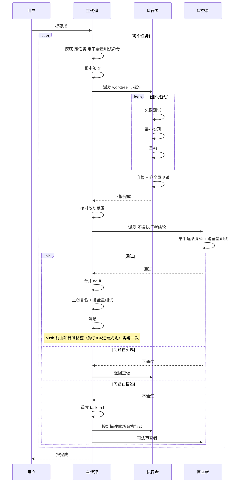

# 编程流程

一份纯流程契约，给两种人用：**人类开发者**（提要求、做裁决）和**具备子代理能力的 agent 软件**（照着它干活）。目的是让 agent 软件开发时**更有效率**——不是让它留更多的记录。更根本的目标是**降低人类开发者的决策成本**：能自己判断的自己判断，能自己收拾的自己收拾，人只在真正需要裁决的地方出现。

这套流程**按任务收费，和改动大小无关**：一个任务至少要预走一遍验收标准、派执行者与审查者各一个独立子代理、建一个 worktree、留四个文件、跑一次合并后复验，外加**三次全量测试**（执行者、审查者、主树各一次；push 那次通常能复用主树的）。小到一个 agent 几分钟能写完、自己一眼能验完的活，不要用它——成本大于收益；项目的全量测试要跑上十几分钟、又没有更快的分层办法时，同样要重新掂量这个成本。

它规定主代理、执行子代理、审查子代理怎么协作，什么算完成，什么不算。它不规定用什么模型、什么子代理机制、什么编程语言，也不附带任何脚本；Git 是唯一被指定的工具。

## 硬前提

**宿主必须能派发具备独立上下文的子代理，并且能读写项目文件、运行命令（含项目的验收测试）、使用 Git worktree。**

独立上下文的判据（它约束的是审查者）：审查者能看到的东西，全部来自派发时传给它的材料、和它被指到的那棵 worktree；它读不到主代理与执行者的对话历史。审查者还必须**能跑命令、能写 `.pipeline/reviewer.md`**——只能读、不能动的审查者等于没有审查。

做不到上面这些，本技能不适用——**不要自己给自己降级**：不要让同一个上下文既实现又审查。没有独立审查，这套流程剩下的部分全部失去意义。

## 角色

- **主代理**：面向用户，决定做什么、以及什么算完成。规划、写任务描述、派发子代理、核对结果、合并。**自己不改产品代码**（合并、跑验收命令、撤销整次合并的 `git revert -m 1`、`git merge --abort` 退出半截合并、审查者留下坏现场时按「还原三件套」复位 worktree、补提交 `.gitignore`、补写公共 gitdir 的 `info/exclude` 条目都不算改代码）。**它负责把流程推到底**：停不停、报不报完成，按第 11 条办。
- **执行子代理**：在隔离 worktree 中实现一个任务，遵循「测试驱动」一节。不动任务描述里的验收标准；标准有问题就报回来，不自行改。
- **审查子代理**：在独立上下文中亲手复验，不采信任何转述，只看代码、测试，和自己跑出来的结果——**包括自己跑的那一次全量测试**。它不提交任何东西，也不替执行者改代码——复验中为了动手验证而临时动过的东西留在工作区不进提交，还原按「临时文件」一节办。
（摸底和会刷屏的活都可以派**一次性子代理**——见「噪声」。**它不是这里列的角色**：不建 worktree、不写 `.pipeline/`、不动产品代码，回到主代理的只有一份结论。）

## 噪声

主代理的上下文用来做决定，不用来通读原始输出。

动手之前先预判：这一步会刷出多少原始输出。按输出性质选处理方式：

- **短输出或结果即结论**：直接保留完整输出。文件读取、小范围搜索、`git status`、`git diff`、版本号、路径和产物检查都属于这一类；输出本身是要判断的结果，不能因为它可能变长就随意隐藏——确实变长的，仍按长输出命令存日志、摘要进来、按需回查，「不隐藏」指要看到能下判断的内容，不是全文必须进上下文。
- **长输出命令**：完整 stdout/stderr 必须保存到系统临时目录；进入当前上下文的是执行摘要和有限预览，不是完整原始输出。摘要至少包含退出码、是否超时、耗时、输出规模、临时日志路径，以及输出的头部、尾部和可机械识别的错误/失败/警告片段。摘要由执行工具或确定性脚本生成，不要求调用 LLM；宿主不支持自动摘要时，由 agent 主动写临时日志并按需读取。
- **探索性噪声**：全仓搜索、翻目录、追一条跨很多文件的调用链，以及不需要主代理亲自持有原始输出的摸底，可以派一次性子代理。它只回传能直接决定下一步的结论，不回传过程或原始输出。

完整日志是可回查的事实，不是摘要的替代品。摘要不足以判断时，读取日志中的相关范围；失败时优先查 stderr、错误/失败片段及其上下文，仍不能判断再扩大范围或重新执行更窄、机器可读的命令。

- **噪声止于一次性子代理或摘要**。主代理不通读与当前决定无关的原始输出；但执行者、审查者和主代理亲自执行的关键验收命令，必须保留完整长输出到可回查的临时日志——宿主存不下时按第 5 条（`degraded` 与 `missingFields`）办。
- **答案的形状在派发时就定死**。摸底确定的那四件事（见第 1 步「读项目约定」）就是这个形状；答不上来的，直接说答不上来。
- **决定权不跟着派出去**。一次性子代理没有用户通道，遇到需要产品决策的，把情况如实回报给主代理；由主代理按第 9 条问用户。
- **它的结论是规划材料，不是证据**。凡要当判据的事实，由主代理亲手走一遍或由审查者复验；必须主代理亲手做的动作（走验收、合并、主树复验）要保留命令、退出码、执行摘要和必要的后置验证，不要求把完整输出全部放进主代理上下文。

## 执行结果结构

执行层（宿主侧的命令执行设施）向 agent 返回**统一的通用外壳**，不试图统一不同命令的业务语义。长输出命令的完整 stdout/stderr 保存在系统临时目录；返回给 agent 的 `preview` 是有限预览，不能代替原始日志。所有字段都保留，未知值使用 `null` 或空数组，不省略字段。

结构固定如下：

```json
{
  "command": "<命令>",
  "cwd": "<工作目录>",
  "status": "completed",
  "exitCode": 0,
  "timedOut": false,
  "durationMs": 18420,
  "error": null,
  "degraded": false,
  "missingFields": [],
  "stdout": {
    "bytes": 1200,
    "lines": 24,
    "previewTruncated": false,
    "preview": "<有限预览>",
    "logAvailable": true,
    "logPath": "<完整 stdout 日志路径>"
  },
  "stderr": {
    "bytes": 8000,
    "lines": 160,
    "previewTruncated": true,
    "preview": "<有限预览>",
    "logAvailable": true,
    "logPath": "<完整 stderr 日志路径>"
  },
  "postcondition": {
    "checked": false,
    "passed": null,
    "summary": null
  }
}
```

字段含义和约束固定如下：

- `status` 使用 `completed`、`failed`、`timed_out`、`failed_to_start` 或 `terminated`。先判断是否超时：超时使用 `timed_out`，即使之后进程被终止也不使用 `terminated`；未启动成功使用 `failed_to_start`；启动后正常退出时，`exitCode === 0` 使用 `completed`，其他整数退出码使用 `failed`；启动后被外部终止且没有退出码时使用 `terminated`，被终止但拿到了整数退出码的按 `failed` 记并在 `error` 写明是被终止的。除 `completed` 和 `failed` 外，`exitCode` 必须为 `null`，并在 `error` 写明原因。`timedOut` 仅在 `status` 为 `timed_out` 时为 `true`。
- `durationMs` 是从执行开始到进程结束、超时或启动失败的毫秒数。`bytes` 按原始输出字节统计；`lines` 按换行符数量统计，若非空输出没有末尾换行则再加一。
- `previewTruncated` 只描述返回给 agent 的预览；`logAvailable` 与 `logPath` 必须保持一致：可回查时为 `true` 和路径，否则为 `false` 和 `null`。长输出命令必须使两路完整日志均可回查；宿主无法做到时将 `degraded` 设为 `true`，把缺失项以 JSON Pointer 字符串（例如 `/stdout/logPath`）写入 `missingFields`，不得宣称满足完整协议。
- `postcondition.checked` 为 `false` 时，`postcondition.passed` 和 `postcondition.summary` 必须为 `null`，表示尚未验证；为 `true` 时，`passed` 必须是布尔值，`summary` 写明验证结论。它由 agent 按验收标准填进执行结果（执行层支持回填就回填进结构，不支持的记进执行摘要或该角色自己的 `.pipeline/` 文件），执行层不能猜测。

测试数量、失败用例、构建产物和迁移状态由测试工具的机器可读输出、项目适配器或明确的后置验证提供；不能从通用 `preview` 或退出码推断出来。宿主按以下顺序适配：

1. 宿主已有结构化命令执行器时，使用它并映射到本结构。
2. 宿主没有现成执行器但能运行脚本时，用宿主可用的 shell（Bash、PowerShell、sh 等）在系统临时目录生成包装脚本，捕获完整 stdout/stderr 并输出本结构；脚本用完即删。
3. 只能直接执行命令时，尽量保存长输出、按上述规则记录可获得的字段并标记缺失（`degraded` 与 `missingFields`）；关键验收必须改用更窄或机器可读的命令，或换能完整保存日志的环境重跑——不能靠一份存不下的日志过关（同第 5 条）。

`执行结果`是固定结构；`执行摘要`只是从它生成、用于节省上下文的有限视图。任何一层都不能用 `postcondition.passed` 代替实际验证。

## 临时文件

**临时文件放在系统临时目录里（`%TEMP%`、`/tmp` 这类），不放进项目。**

- **谁写的都算。** 临时文件是那种用完就该丢、本来不该留在仓库里的东西：为跑一次命令写的脚本、下载下来的数据或工具、跑测试时生成的输入、中间产物——主代理、执行者、审查者、一次性子代理，谁写的都一样。
- **放进项目就不算临时。** 项目里不建 `.tmp/` 这类目录——执行者的 `git add -A` 会把它捡进提交，主树里也会多出与任务无关的文件。
- **要留在仓库里的不在此列。** 交付物、测试代码，和测试要用的夹具与样例数据，照旧进项目；`.pipeline/` 里那四个文件也一样，它们就该待在 worktree 里（见「`.pipeline/`」一节）。每个进不进提交的新文件都先在任务描述（`task.md` 上段）里写明：进提交、执行者把它提进分支，会被第 5 步「改动是否只落在任务描述的范围里」的核对看见；不进提交，把它的路径记进 `task.md` 上段，并写进公共 gitdir 的 `info/exclude`——即 `git rev-parse --git-common-dir` 所指的主仓 `.git/info/exclude`（公共条目对所有 worktree 与主树同时生效；私有 gitdir 的 `info/exclude` Git 不读，别写）。**条目必须锚定到具体路径、且带 `<id>`**（`/<id>-…` 或完整相对路径），不许写裸目录或裸通配——`info/exclude` 是全局的，一条 `out/`、`*.log` 会让并行中的别的任务、以及主树里的合法文件被 `git add -A` 静默跳过，直到主树复验才发现少了文件，而 git 不报任何错。记进 `task.md` 是清场回收这些条目的唯一依据；条目生效期间对主树同名路径同样屏蔽。归属裁决不了时，按「停下来问用户」一节处理。
- **这条管新写的文件。** 已经在项目里的文件被临时改过，那是改动，不是临时文件——审查者留下的临时改动照旧留在工作区，不进提交：执行者被再次派发时（退回重做、重写描述后重派、解冲突），先把 worktree 恢复到**检出在 `<id>` 分支尖端、没有进行到一半的 git 操作（merge、rebase、cherry-pick 都算，`git status` 会报出来）、工作区干净**（tracked 改动还原，未跟踪临时文件删掉；`.pipeline/` 与登记进 `info/exclude` 的文件被忽略、不受影响）——这三项下称「还原三件套」。审查者逐个检出测试提交后没回到尖端的、解冲突解到一半的、接基底接了一半的，都在这一步发现并复位；不然下一次 `git add -A` 会把残留扫进提交，或者提交根本落不到 `<id>` 分支上。**只有同一份描述下接着中断的活干（执行者被打断、超时，或恢复后续干）不还原**——那是执行者自己的在制品，按 `progress.md` 与工作区现状接着干，不要清掉；描述已经换过的，旧的在制品同样作废，一并还原。

## 用户行为

**用户行为**：术语见同目录 `GLOSSARY.md`。

- 入口可以是按钮、命令、接口、配置文件；状态变化可以是界面、数据库、文件、日志。
- 「改了三层代码」不是用户行为，「用户点了 X，Y 变了」才是。
- 重构、基建、文档：找出它的可操作入口和可观察状态变化，套进同一个形状（比如一份文档的入口可以是「人照着它做」，状态变化是「他做出来的东西变了」）。套不进去，就把它拆到能套进去为止。


## 任务

**任务**：术语见同目录 `GLOSSARY.md`；审查可以来回几轮。

几个行为能合成一个任务，**当且仅当它们共用同一条链路**——**判据是「同一个可操作入口 + 同一份数据」，两条都满足才合并**；「同一段代码路径」只是常见结果，不是第三条门槛，不要用它把该合并的拆开。入口或数据不同的，各做各的。

**每个用户行为有一条或多条验收标准**：正常走通是一条，被拒绝、边界、异常各是另一条。

## `.pipeline/`

`.pipeline/` 在子工作树里（`<worktree>/.pipeline/`）—— 进行中的任务，状态都放在这里，**一个任务一份**，寿命就是那个任务的寿命：worktree 被删掉，它随之消失。`<id>` 是这个任务的短标识（kebab-case），同时用作 worktree 目录名和分支名。

四个文件。规则是**一个文件一个写者，且每个文件回答一个别人没回答过的问题**：

- **`task.md`** —— 只有主代理写。上段是任务描述（目标、范围、验收标准，每条标准标注「本轮新行为」还是「预走时已成立（回归）」，**入口自动化不了的另标「无自动化验收测试」**），写完不再改；下段是终态，合并后才写（合并提交、主树复验结果、已合并可清场）。**它回答：要做什么。**摸底确认的那个主分支名、未提交改动清单、**本任务分到的环境资源实例**、**共享数据文件的初始值或重建步骤**、**全量测试的命令（分了两套就两套都记）**、**三档各占多少（只作观察，不作阈值）**、**不稳定测试排除清单的路径与时限天数**、以及**哪几条标准没有自动化验收测试**也记在上段。
- **`progress.md`** —— 只有执行子代理写。**它回答：还剩什么。** 把这次要做的拆成若干步，每步后面写它现在是什么状态——用你自己的话，不规定词表。随时覆盖，永远只反映当前。
- **`executor.md`** —— 只有执行子代理写。**它回答：发生了什么。** 宣布完成时写一次，详略得当，给主代理看。
- **`reviewer.md`** —— 只有审查子代理写。**它回答：复验看到了什么。**（落笔顺序与对照按第 5 步，半截结论按「重派前清理」删。）

四个文件都是散文：没有 schema、没有必填字段、没有机器可读区块。**要加第五个，先回答它解决的是哪个还没人回答的问题**——两个文件回答同一个问题，就说明有一个是多余的。这个问题是改这份契约时要回答的，不是在单次任务里加文件的口子。

作废的旧结论文件，在重派前删（下称「重派前清理」）：描述重写、或改派执行者（换人接手）时，删上一轮的 `executor.md`、`reviewer.md` 与 `progress.md`；只是重派审查者（执行者不换）时只删 `reviewer.md`。

**恢复 = 盘点残留（下称「恢复」一条）**：按**四个**发现源盘点——`git worktree list` 的登记条目、`.worktrees/` 下的实际目录、`git branch --list` 扫出的 `<id>` 形态分支、公共 gitdir 的 `info/exclude` 里带任务标识的条目（`git rev-parse --git-common-dir` 所指那份）。**四个都干净**才没有残留、正常往下走。

**第四个源不能省**：前三个都干净、只有 `info/exclude` 里压着一条旧条目，是最容易漏的那种残留——它不影响登记、目录、分支任何一项，但漏删的条目会让主树里同名的合法文件被 `git add -A` **永久静默忽略**（不报错、不改退出码），直到某次主树复验才发现少了文件。

**任何一个不干净，就去读同目录的 `RECOVERY.md`**——{登记, 目录, 分支} 三态表（8 种组合）怎么处置、并入判法、repair 与重挂、清场变体，全在那里。这份契约不重复它们，只留**三条**不许绕过的：

- **认不出是谁的残留，别动。** 认得出的判据（含跨会话可用的归属证据）、以及认不出时的处置，见 `RECOVERY.md`。
- **判成「已并入」之前，不许删任何东西。** 并入判法（含 revert 与手工撤销的识别）见 `RECOVERY.md`。
- **恢复成续干的任务，要计入在跑数。** 串行时先把它推到清场再开新任务；并行时计入「任务间并行」的在跑数——它占着一个 worktree、一份上下文。

下面这条不属于「恢复」，但它一直在这节里，别在搬走之后以为它也搬了：

**没有独立的「删除 `.pipeline/`」这个动作**——清场就是第 7 步那几步，不是只删 worktree。执行者任务中新发现一个「不进提交但必须在 worktree 里」的文件的，照「标准有问题就报回来」同款通道报回，由主代理补记到 `task.md` 上段、加 `info/exclude`，处理完回复执行者继续（告知 exclude 已生效）——非描述性记录（主分支名、未提交改动清单、不进提交路径、环境资源实例、共享数据文件初始状态、全量测试命令）允许主代理追加到上段末尾，不算改描述、不作废审查。

项目的 `.gitignore` 必须**在创建第一个 worktree 之前**就提交 `/.worktrees/` 与 `/.pipeline/`。前者让主工作树看不见整棵子工作树。后者不是给主工作树用的（主工作树里根本没有 `.pipeline/`）——它是给子工作树自己用的：`.gitignore` 里的 `/` 锚定在它所在的目录，同一个文件检出进 `.worktrees/<id>/` 后，`/.pipeline/` 在那里重新生效；少了它，执行者的 `git add -A` 会把 `.pipeline/` 提交进分支。

## 流程

总览如下图（只画骨架，规则以下文为准）。本节与「`.pipeline/`」一节里主代理的 git 命令一律以主工作树根目录为 cwd。



1. **规划**：先摸底，再定下一个任务（一个或几个共用同一条链路的用户行为），给它一个短标识 `<id>`。摸底按这个顺序走——前两步在定任务之前，后四条在定下任务与 `<id>` 之后：
   - **查主工作树状态**：先 `git status` 记下状态——有进行到一半的 git 操作（merge、rebase、cherry-pick 都算）的，停下来报给用户，由他整理完再继续；同时确认检出在主分支上，不在的同样停下来交用户整理——**这一条要排在恢复之前**，恢复里的基底与主分支名都靠它定下来。主分支是哪个也要在这里定下来并记进 `task.md`：先看 `git symbolic-ref --short refs/remotes/origin/HEAD`（输出形如 `origin/main`，去掉 `origin/` 才是本地分支名），取不到就按项目惯例（`main`、`master`），但取到的名字必须是**本地分支**、真实存在（`git rev-parse --verify refs/heads/<名字>`）且与当前检出一致，都对不上就问用户，别把猜出来的名字写进去（写成 `origin/main` 这类远端引用会让后面的 `git diff`、`git log`、`git worktree add` 静默算错基底）。然后按「恢复」那四个发现源盘点未关闭的任务，任何一个有残留就先按「恢复」处理（只看登记条目会让没登记的目录和孤儿分支永远没人发现），处理完再继续规划新的；恢复成续干的任务，串行时先把它推到清场再开新任务，并行时计入「任务间并行」的在跑数、新任务照那一节的判定走。
   - **读项目约定**：读 `AGENTS.md` 之类，如果有；并确定四件事——产品定义在哪、术语在哪、测试怎么跑（**指全量测试，见「全量测试」一节：命令、目录、单次耗时、吃掉哪些共享资源、三档各占多少、退出码可不可信**）、什么不能碰。**顺带查两样东西在不在**：push 前那道检查（机制不限，判据见「全量测试」一节，且要按那一节末**故意让它失败一次**确认它真能拦）、以及共用代码有没有被别的任务在同一条链路上用着。摸底可以派一次性子代理去做（它有自己的上下文），结论不落盘。
   - **查与任务的冲突**：定下任务后再查一次 `git status`，未提交改动（含未跟踪文件）和本任务要改的文件有重叠的，停下来交用户整理——提交、stash 还是丢弃由用户选，主代理不代做；不重叠的记下即可，这份记录随 `task.md` 上段留下，主树复验失败时还要拿出来对照。主代理自己预走验收或主树复验留下的产物不算。用户已提交进主分支的推进也不用停，那是正常的 HEAD 前移，合并时真有冲突按「合并有冲突」办。
   - **清旧版残留**：项目里如果还留着旧版技能的东西——根目录有 `pipeline_tools/`，`.pipeline/` 已经被 Git 跟踪，或者 `docs/tasks/` 下还压着旧版任务单（带 `<!-- Task ID: -->` 标记，或写着 `pipeline-contract` 区块）——说明它是从旧版迁过来的（旧版把任务证据提交进 Git，新版不提交）：先读本技能同目录的 `MIGRATION.md`，把该清的文件和理由当面说给用户，得到许可再动（这属于第 9 条的「缺用户许可」）；用户说不清理就不清，别问第二次——但「`.pipeline/` 已经被 Git 跟踪」这一条例外：`.gitignore` 对已跟踪的文件无效，不清就会让 `git add -A` 把 `.pipeline/` 提交进分支，至少要 `git rm -r --cached` 取消跟踪**并落进提交**才能开工（只改 index 不提交，建 worktree 检出旧 HEAD 时 `.pipeline/` 仍被跟踪），这个后果要连同选项一起说给用户。
   - **定下任务之后**：**预走之前先取快照**——`git status` 记下已有的未提交改动、把项目会写的外部共享状态（数据文件、本地库、缓存）当前值记进主代理自己的会话记录，**预走本身会改掉它们**，事后再取就晚了（迁移类项目尤其明显：预走跑一次 `migrate`，数据就从 v1 变成 v2，回不去）。然后把这份快照抄进第 3 步的 `task.md` 上段。预走时若写脏了 tracked 文件，**记下是哪个文件、缺什么可重定向参数**，第 3 步一并处理。
   - **再亲手走一遍，看标准现在是不是已经成立**——**整组标准全都已成立**的，说明任务已经被满足、或标准没抓到真实变化，重选任务或重写标准；不要用「搜不到相关代码」当作标准尚未成立的依据。**同一个用户行为下的标准不必条条都从一开始不成立**：边界、拒绝、异常这类在现状下成立是正常的（写它们是为防退化），按**回归测试**处理——不要求先红、可与实现同一提交、**不占**「一次只做一条标准」的位置（不必为它单开一轮「先红→实现→重构」），测试仍须写、仍须覆盖该条。**注意「回归测试」是这条标准自己的性质，不是「全量测试」**——后者是项目全部测试跑一遍，见「全量测试」一节，两件事。**逐条标注写进第 3 步的 task.md**，否则下游只能靠猜。这一走由主代理自己留下的产物，走完就清掉、别让它混进下一轮对照。并行与否在这一步按「任务间并行」定，串行照第 11 条。
2. **建 worktree**：`.gitignore` 已按上一节提交那两条才建——没有先在主工作树补上并提交（文件本身有未提交改动时按第 10 条交用户整理）；再确认主工作树仍检出在摸底确认的那个分支上，不在的按第 10 条交用户整理；然后由主代理从主工作树当前 HEAD 建 `.worktrees/<id>`（`git worktree add -b <id> .worktrees/<id>`）。`.pipeline/` 被 Git 忽略，不随检出出现，到第 3 步写 `task.md` 时才建立。`<id>` 已经被一条已有分支占用：认得出是上个任务残留的（本会话或 `task.md` 里出现过这个标识），先按「恢复」处理它，不要把这个新任务挂到旧分支上继承它的提交，也不要为躲开它另起一个 `<id>` 把旧任务晾在原地；认不出是谁的分支（比如用户自己的同名分支），停下来问用户，别占也别删。**目标目录 `.worktrees/<id>` 已经存在**（命令报 already exists）的，说明那是个没登记的残留目录，按「目录在、登记不在」处理。
3. **写任务描述**：写进 `<worktree>/.pipeline/task.md`，含验收标准。**每条标准后标注它是「本轮新行为」还是「预走时已成立（回归）」**——这个判断只有预走的主代理知道，不写下来执行者与审查者都无从执行第 4 条的例外。**范围里要写明执行者将要新建的测试目录或路径前缀**（如 `tests/`、`__tests__/`）——不然第 5 步的白名单会把验收测试本身判成越界；按前缀匹配，不必逐个列文件。写完不再改——要改就重写上段，作废此前的审查结论，按「重派前清理」删掉上一轮三个文件（非描述性记录追加到上段见「例外与词汇」表）。
4. **派执行子代理**：传入 worktree 绝对路径、验收标准、摸底结论（任务描述就在它 cwd 的 `.pipeline/task.md` 上段），**连同分给本任务的环境资源实例**（端口、库名/数据文件名，见「任务间并行」）。它先按「`.pipeline/`」一节建 `progress.md`，然后按测试驱动做；做完**自检**（按验收标准亲手走一遍，**再跑一次全量测试**，查后置状态），自检时记录命令、退出码、执行摘要；回报完成前确认 `git status` 干净（`.pipeline/` 与被忽略产物除外）——**自检把仓库里的数据文件写脏是正常的**，那就把它还原回原值再回报，并在 `executor.md` 里记清「改了哪个文件、原值/新值」；**验收测试会写脏 tracked 文件的项目，标准里就要写明数据文件可重定向**（用 `--store <临时路径>` 这类参数；项目本来没这个参数的，先在标准里把它写成任务范围内的一个验收项，或按第 9 条问用户要不要加，别自己加）。**第二条要当心**：标准的验的正是「跑完之后副作用留下了什么」（例如「二次 migrate 打印 `already 2` 且不重写备份」）时，**还原值会让它变成假失败**——这类标准必须把前置状态一起写清（「从 v1 的 store 开始」），还原时连同前置状态一起重建，别只把文件拷回去。**全量测试不是绿的就不许报完成**——它挂了就说明这一轮改坏了别处，那是本任务的事，不是「本来就坏」（本来就坏的按第 9 条问用户，别自己判成无关）。自检通过后写 `executor.md`，再回来回报完成。
5. **派审查子代理**：主代理先核对执行者的回报与提交——**改动是否只落在任务描述的范围里**（先用 `git diff <主分支>...<id>` 这类与当前主分支的 merge-base 比列出实际改了哪些文件，**再逐个看 `git log --name-only <主分支>..<id>` 的文件清单**——只看 diff 会漏掉「改了又改回去」的越界：净效果为零的文件在 diff 里根本不出现，只有提交清单暴露它；别拿 tip-vs-tip 的两点 `git diff <主分支> <id>` 当基准，它会漏掉主分支前移后别人的提交——最后逐项对照 `task.md` 上段写明的范围，**范围是白名单**：不在上段的文件就算越界，哪怕只改一行；**两个例外**：上段已写明的测试路径（第 3 步要求写进去）、以及「问题在描述」里已声明作废的旧提交所涉文件——这两类不算越界），确认 worktree 检出在 `<id>` 分支尖端、工作区干净，再传入 worktree 绝对路径、同一份任务描述（`task.md` 上段，不含终态）、验收标准、摸底结论，并告知改动范围（改了哪些文件、哪几个提交，只列属于当前描述的）。**派发材料里不带执行者的结论。** 审查者亲手复验、亲手逐条标准走一遍入口，**并自己跑一次全量测试**；长输出命令保留完整日志并按需回查，不能只采信退出码或摘要；**先把自己的结论写进 `.pipeline/reviewer.md`，再读执行者留下的东西**（`progress.md` 与 `executor.md`）对照。
6. **合并**：主代理核对证据后合并到主分支，按这个顺序走：
   - **合并前**：检出状态按第 2 步同款再确认一次，不在的按第 10 条交用户整理。合并成功**不改**清场时机——清场仍只在主树复验通过、终态写过之后（第 7 步）；主树复验不通过时要留着这棵树与四个文件。
   - **执行合并**：合并必须产生合并提交（用 `git merge --no-ff`），合的是分支上的提交，审查者留在工作区的临时改动不进提交。
   - **主树复验**：主代理在主工作树按验收标准亲手走一遍（同第 7 条要求），**含跑一次全量测试**，**产物按「清掉未跟踪的、还原被改过的 tracked 文件（`git checkout --`）」，判据是 `git status` 回到复验前**。**复验前先排掉两类 git 看不见的污染**：
     - **①本任务的 worktree 里还有活着的进程**（服务、watcher、测试挂住、`cd` 进去的 shell）——它会抢走端口或数据文件，让复验打到 **worktree 的代码**上、拿到假通过。**别用「端口能不能起」判**：Windows 上 `SO_REUSEADDR` 允许两个进程同时 bind 同一端口、双方都 LISTEN 且都不报错，请求只会落到其中一个；**也别指望按端口反查 PID**：两个进程命令行可能逐字相同，而 `Get-NetTCPConnection` 在双监听者下常只回一行、返回哪个 PID 还是交替的（`netstat -ano` 才看得到两行）。**真正的解法是「从一开始就知道是哪个进程」**：起服务时用 `Start-Process -PassThru`（POSIX：`cmd & echo $!`）**把 PID 记下来**，停的时候按 PID 停——别事后按端口或目录反查。**事后补救只能靠「目录还被占着吗」这类间接信号，而且它不可靠**：`Rename-Item` 一个还有进程 cwd 在里面的目录，在 Windows 上**仍可能成功**（只有持有文件句柄才失败），所以 rename 成功**不能**证明没进程。因此：PID 丢了就先按第 9 条问用户，别用间接信号赌。
     - **②共享的外部状态被写过**（本地数据库、`store.json` 这类数据文件、缓存、外部服务沙箱）——复验要用的初始状态是 **`task.md` 上段记的那份**（见第 1 步与第 3 步：预走之前就要取，预走本身会改掉它），复验前照它恢复；**恢复必须在停进程之后**，否则会静默写进一个正被别的进程读的库。没记初始值、或恢复会毁掉用户/并行任务的数据时，按第 9 条问用户，别自己删。
     这两类都不在 `git status` 里，**别拿「主树干净」当作复验环境没问题**。
   - **通过之后**：才把 `task.md` 的终态段写成**已合并、可清场**（连同合并提交与主树复验结果；复验经用户裁决豁免的写「已合并、复验经用户裁决豁免」）。
7. **清场**，按这个顺序走——**顺序错了会丢东西或留现场**：
   - **先把要用的东西取出来**：按 `.pipeline/task.md` 记的路径取出 ①`info/exclude` 里本任务的条目 ②各文件与回报里记录的临时日志路径，**抄进主代理自己的会话记录**（`.pipeline/` 马上要删，写那里等于没取；也不许在项目里新建文件记它）。exclude 条目本身删完 worktree 也还在 `info/exclude` 里读得到，真正会随 `.pipeline/` 一起丢的只有日志路径与「哪些条目是本任务的」这条对应关系。
   - **停掉这个任务起的进程**（清单见第 6 步主树复验）。worktree 里若还跑着服务、数据库、watcher、`cd` 进去的 shell，`worktree remove` 会因文件占用失败（Windows 上是 `Permission denied`），**而且失败前它已经删掉了文件与 `.pipeline/`、也移除了登记**，只留一个空目录加 `.git` 与分支——这一格极难辨认，见「目录在、登记不在」那条。
   - **收拾主树复验留下的现场**（见第 6 步）：未跟踪的产物清掉、被改过的 tracked 文件用 `git checkout --` 还原，**判据是 `git status` 回到复验前**；`task.md` 上段若记了共享数据文件的初始值，**按它把外部状态也恢复回去**——这一步必须在停进程之后做，否则会静默写进一个正被读的库。漏了它清场结束后主树还是脏的、撞第 10 条。
   - 删掉第 ① 项那些 `info/exclude` 条目（漏了它条目就永久残留，之后同名的合法文件会被静默忽略、`git add -A` 再也捡不进提交）。
   - 再**两条命令**删干净：先 `git worktree remove --force .worktrees/<id>` 删工作树，后 `git branch -D <id>` 删分支——顺序不能反：分支被 worktree 占用时 `branch -D` 会报 `cannot delete branch`，而 `worktree remove` 不删分支、漏了它每次清场都留一条孤儿分支。`--force` 是防御性的：worktree 里若有未登记或非忽略的残留，普通 `remove` 会被拒；丢弃 `.pipeline/` 正是清场语义。
   - 最后清理临时日志——走到这一步失败日志的保留条件也已满足，一并清掉；各角色清自己写的，主代理按刚取出的路径清子代理留下的。任务没走到这一步就结束的（规划中止、摸底完发现不做），摸底阶段那些一次性子代理留下的日志，同样由主代理按回报里的路径清掉。

审查不通过、合并失败、中途放弃、执行期间报回，这几种情况分别怎么办。

- **执行者执行期间报回**：「标准有问题」的，核对属实按「问题在描述」办（此时还没派过审查者，不涉及「重派审查者」）；核对认为标准没错的，回复执行者按原描述继续。报回「做不了/卡住」的，涉及产品取舍或任务是否还值得做的按第 9 条问用户，不许主代理自己改标准收窄范围；确属标准写错（意图明确、只是表述有误）的，才按「问题在描述」重写。

- **审查结论无效**（半截、或主代理当场核对发现它判错了）→ 重派之前，由主代理把 worktree 按「临时文件」一节那三件套还原（上一任动过手、或检出测试提交留下的现场，都要收掉），只删 `reviewer.md` 重派审查者，执行者不回退；实现侧确有缺陷的（含审查者漏判的「通过」）仍按「问题在实现」办；
- **问题在实现**（跑不通、做错了）→ 原地重做，重做完按「重派前清理」删掉上一轮 `reviewer.md` 再派审查者——别让新审查者一开文件就读到上一轮的裁决；
- **问题在描述**（标准本身错了）→ 重写任务描述，按「重派前清理」删掉上一轮三个文件（别让下一轮的人读到作废的结论），重新派执行者与审查者；重写出来的新标准同样要先按第 1 步「定下任务之后」那一条亲手预走一遍，已经成立的照那一套办——重选即放弃该任务，按第 7 步清场。`<id>` 分支上为旧描述写的提交已经作废——重派时说明哪些不再算数（或让执行者先清掉与新描述无关的提交），派审查者时「哪几个提交」只列对应当前描述的。
- **合并有冲突** → 若主工作树有进行到一半的合并（`git status` 会报出合并进行中，或看 `.git/MERGE_HEAD` 是否存在），先 `git merge --abort` 退出中途状态（这是收尾，不是解冲突、也不算改产品代码；留着它下一轮 `git merge` 会被拒绝，还会撞上第 10 条）：不要主代理自己解，退回执行者（worktree 的还原按「临时文件」一节由再次派发的执行者做），让它在自己的 worktree 里把主分支并进来、解冲突、重跑验收，然后重新走第 5、6 步；重派审查者前按「重派前清理」删掉上一轮 `reviewer.md`；
- **主树复验不通过**（worktree 通过但主树不通过）：
   - **先排污染**：对照摸底记下的清单与主树 `git status`——复验失败是被未提交改动污染的，停下交用户整理、重跑复验，不算实现问题；**也别忘 git 之外那两类**（worktree 里活着的进程、共享数据库/数据文件被写过，见第 6 步），同样不算实现问题。
   - **确属实现问题**：撤掉这次合并（见下面的撤法），保留 worktree 与四个文件，按「问题在实现」退回执行者重做——**不许写「可清场」，不许清场**。退回时把这次复验的失败记录一并交给执行者当线索（`reviewer.md` 里只有审查者在 worktree 的「通过」，没有这次失败的信息），按「重派前清理」删掉上一轮 `reviewer.md` 再派审查者。
   - **标准本身写错了**：先按第 9 条问用户保不保留当前结果。**保留**的终态只记「已合并、主树复验未通过」，同样不清场——这个任务在「任务间并行」的在跑数里占一个永久名额，直到用户另作处置（说撤就按上面的撤法撤合并、说清就按 `RECOVERY.md` 的清场变体收工——worktree 与分支都还在时那也就是第 7 步；**别只写「执行第 7 步」**，撤合并与清场之间若被打断，登记或目录可能已经缺了一件，那时得走变体。名额占满时主代理主动提示用户）。**不保留**才撤掉合并、再按「问题在描述」重写任务描述。
   - **撤法**：`git revert -m 1 <那个合并提交>` 这类不丢主分支已有提交的方式，不许 reset。**撤之前先按 `RECOVERY.md` 的 revert 判法看一眼是否已经撤过**——撤过的说明撤合并这步已完成，回到本条目原路径继续（该退回的退回、该重写的照常写），不因此清场；只有用户选「放弃」时才跳过 revert 直接收工——此处「放弃」指**整任务作废、那条合并留在主分支上不再处置**，不是「不保留」（不保留仍要先撤合并、再按「问题在描述」重写描述接着做，见上面的「标准本身写错了」与 `RECOVERY.md`「补验分支」第 1 步）；用户要的是「把合并也撤掉」的，走 `git revert -m 1`，那不叫放弃。revert 撞冲突（`.git/REVERT_HEAD` 在场、工作区留冲突标记）的，`git revert --abort` 退出中途态再按第 9 条问用户，别自己解。
   - **撤完要把分支接回去**，两条路，看重做时有没有**改写分支历史**：
     - **只是往后追加了提交**（「问题在实现」的原地重做就属这种）→ 先 `git revert` 掉那条 revert（把主线还原回分支的原基底），再 `git merge --no-ff <id>` 就干净接上，原改动与新增提交一起回主分支。**别把「重新合并会冲突」当成必须换基底的依据**——这种情形的坑是没先 revert 掉那条 revert：不先 revert 就直接合并，被撤的原改动保持撤销状态，而新提交若没碰到那些行，`git merge` 会静默成功、不报任何错。
     - **改写了历史**（「问题在描述」要求清掉作废提交就属这种，merge-base 退回分支的原基底）→ revert-the-revert 之后重新合并不再干净，只能让执行者把分支接到新的基底上（rebase / cherry-pick 到当前主分支尖）。
- **用户中途说不做了** → 和第 7 步清场同一个动作，只是放弃了就不必再留失败日志，这个任务的临时日志一并清理（「失败日志留到查清为止」一行的例外）。**若合并已落地、主树复验未做**，已合进主分支的代码不能没人处置——先按第 9 条问用户撤不撤该合并（`git revert -m 1`），再清场。

主代理自己在第 5、6 步核对不通过的（改动越出任务范围、证据对不上），同样按「问题在实现」退回执行者；如果这时合并已经落地，先按「主树复验不通过」那套撤掉这次合并再退回，别把坏内容留在主分支上。核对不过但现场明显是上一任审查者留下的（半截检出、临时改动、`reviewer.md` 缺失），按「审查结论无效」办——主代理还原后直接重派审查者，别让执行者白跑一轮重做。
不另起 `<id>`，不留接替痕迹。

## 停下来问用户

**停下来问用户，不是把问题原样丢回去。** 只描述「这里需要你决定」而不给判断，等于把决策成本原样还给用户。

能停下来的只有这几种情形：第 9 条、第 10 条、「临时文件」里裁决不了的归属，以及恢复与建 worktree 时认不出身份的残留（`.worktrees/` 下认不出的目录/登记条目按第 9 条问用户，别静默别动）。停的时候都按同一个问法：

1. **说清卡在哪。** 哪一步、哪条规则、什么事实让流程走不下去。写当场看到的东西（命令、退出码、文件状态），不写推测。
2. **给出你的建议。** 你认为该怎么办、理由是什么。建议可以不止一条，但要指明你推荐哪条——没有推荐的建议，等于把选择原样推回去。
3. **写成几个选项。** 每个选项一句话说清它会导致什么后果，让用户不用重建你的上下文就能选。
4. **永远留一个「其它」。** 用户在里面写自己的判断，包括推翻你所有建议。不许用「以上都不是」把选择收窄回你给的那几条。
5. **选完就按它走。** 用户选了哪条就是哪条：不追问、不再问一遍、不把自己没被采纳的建议再讲一遍。

宿主有选项式提问就用它——点一下就能答；没有就写成编号列表，同样带「其它」。

## 任务间并行

多个任务可以同时推进，**任务内部照旧走「流程」那七步**——并行不改变执行、审查、合并各自由谁做、按什么顺序做。默认形态仍是串行；以下判定同时成立才并行：

- **同时在跑的任务不超过三个**（在跑 = worktree 还没清场）。每个在跑的任务都有交错的回报要核对、复验要亲手跑；超了，先崩的是决定质量。
- **摸底确认共享资源不互踩。** worktree 只隔离文件，不隔离端口、数据库、构建缓存这类环境资源。**第一件要做的是让测试自带环境**：一条测试自己建、自己清它需要的东西，不依赖共享的库、不留共享的残留、不假设执行顺序。**这种测试并行时不需要分配任何实例**——它自己就是隔离的。所以顺序是：**先把测试改成自带环境，再给剩下的分配实例**；把分配实例当成默认方案，等于放弃了从根上消除冲突的机会。**判据是「它碰不碰同一个具体实例」，不是「它是什么档」**。

  剩下那些必须吃共享实例的（连一个真库、占一个固定端口、读一份共享数据集），才走下面这套：**判据是「每个任务能不能分到互斥的实例」，不是「两边有没有同类资源」**——同类型不算冲突（每个任务都要一个端口、一个测试库），要的是**同一个具体实例**被两个任务同时用。所以：①先列每个任务要用的互斥资源——**要列全一组，不能只列主文件**：监听端口、独占的数据库/schema、**锁文件、WAL/journal、备份文件、迁移状态/版本表、PID 文件**、外部服务账号；**全量测试算一个用资源的动作**（它会起服务、连库、写数据文件），它吃的那组资源必须和别的任务错开，否则两份全量测试同时跑会互踩、拿到假绿；②给每个任务分配不同实例（端口 +1、**该资源组的所有路径**都带 `<id>`——只改主文件名、留下同名的 `store.lock` 仍会互斥），把分配结果写进它 `task.md` 上段；③**再求一次交集，非空就不并行**；④**不可分配的固定资源直接判不并行**——端口或路径写死在代码里改不了、共用一个外部服务账号、只能有一个实例的守护进程，这些属于真阻塞，别指望第②步解决（能不能配，第 1 步摸底就要查清；配不了就把「加可重定向入口」写成任务范围内的一个显式验收项，或干脆串行）。并发安全的资源（构建缓存、只读依赖目录）列出来但不参与比对。写不下来哪一样就是「确认不了」，同样不并行。第 4 步派执行者时把分给它那组实例一起交代，**执行者只能用清单里分给它的那组**，要新开资源或换端口，照「标准有问题就报回来」的通道报回，别自己挑一个。

  剩下的那些必须吃共享实例的（连一个真库、占一个固定端口、读一份共享数据集），才走下面这套：**判据是「每个任务能不能分到互斥的实例」，不是「两边有没有同类资源」**——同类型不算冲突（每个任务都要一个端口、一个测试库），要的是**同一个具体实例**被两个任务同时用。所以：①先列每个任务要用的互斥资源——**要列全一组，不能只列主文件**：监听端口、独占的数据库/schema、**锁文件、WAL/journal、备份文件、迁移状态/版本表、PID 文件**、外部服务账号；**全量测试算一个用资源的动作**（它会起服务、连库、写数据文件），它吃的那组资源必须和别的任务错开，否则两份全量测试同时跑会互踩、拿到假绿；②给每个任务分配不同实例（端口 +1、**该资源组的所有路径**都带 `<id>`——只改主文件名、留下同名的 `store.lock` 仍会互斥），把分配结果写进它 `task.md` 上段；③**再求一次交集，非空就不并行**；④**不可分配的固定资源直接判不并行**——端口或路径写死在代码里改不了、共用一个外部服务账号、只能有一个实例的守护进程，这些属于真阻塞，别指望第②步解决（能不能配，第 1 步摸底就要查清；配不了就把「加可重定向入口」写成任务范围内的一个显式验收项，或干脆串行）。并发安全的资源（构建缓存、只读依赖目录）列出来但不参与比对。写不下来哪一样就是「确认不了」，同样不并行。第 4 步派执行者时把分给它那组实例一起交代，**执行者只能用清单里分给它的那组**，要新开资源或换端口，照「标准有问题就报回来」的通道报回，别自己挑一个。

并行之下，这几条有特殊含义：

- **摸底共享。** 同一批并行任务的派发材料装同一份摸底结论，不必每个任务重摸一次。
- **派完执行者就规划下一个。** 一个任务在等执行者或审查者回来，主代理就去规划下一个——串行等待正是并行要消掉的成本。
- **合并是串行闸门。** 一次只合一个任务；主树复验永远针对合并时刻的 HEAD——worktree 建在哪一刻的 HEAD 不作数。后合并的任务合并时与主树冲突的，按「合并有冲突」办。
- **审查不互相借。** 每个任务有自己的审查者；任务 A 的审查结论对任务 B 不作数——B 面对的代码可能已经被 A 的合并改过。

## 全量测试

**全量测试 = 项目里全部自动化测试跑一遍。** 它是防「本任务验收全绿、别处已经坏了」的唯一手段：验收测试只证明这一条标准的入口通了，证明不了共用的代码没被这一轮改坏。

**第 1 步摸底就把它定下来**（四件事里的「测试怎么跑」），答不上来就不是一个能干活的状态：全量测试的命令是什么、从哪个目录跑、单次耗时多少、要吃掉哪些共享资源（端口、库名/数据文件名）、退出码可不可信、以及**三档各占多少**。**没有这个命令的项目，第一个任务就是把测试集合建出来**——这是范围里的一项，不是顺带。

**先按「用什么资源」把测试分档，再谈快慢。** 按耗时切会漂——机器慢一点、依赖多装一个，同一条测试就换档了；按资源切不会，而且**能被工具强制**（不守规矩的测试可以被判失败，不是靠人自我声明）。三档判据只写资源，不写代码量、不写测试类型名词：

| 档 | 允许什么 | 典型代价 |
|---|---|---|
| **单进程档** | 单进程（能限单线程更好）；**不许网络、不许碰磁盘、不许 sleep 与阻塞调用** | 毫秒级，确定性最高 |
| **单机档** | 多进程、线程、访问 localhost、起数据库、开浏览器；**不许连本机之外的网络** | 秒级，有不确定性 |
| **跨机档** | 什么都可以，含远端环境 | 分钟级，不确定性最高 |

**分档与「测多少代码」是两件事，别绑在一起。** 一个覆盖整个接口处理链路的测试，只要用替身挡掉了库和文件系统，它就是单进程档；一个只验一个方法的测试，如果非要起浏览器（现代前端组件常见），它就是单机档。**档位由它碰什么资源决定，不由它验多少代码决定**——所以「这是单元测试所以应该快」这种推断不成立，要看它实际碰了什么。

**分档是为了让「快」和「稳」可判，不是为了凑比例。** 不要照抄任何外来比例（金字塔、冰淇淋锥、70/20/10、80/15/5 之类）当验收阈值——那些是别的团队在其规模下的经验值，写成本项目的硬指标只会变成新的形式主义。本项目三档各占多少，摸底时定，写进 `task.md` 上段，仅作观察用。

**跑不完怎么办**：单次命令预算内跑不完的，分两套——**快速集合**（取单进程档，每次提交都跑，给执行者的高频循环用）和**全量集合**（下面四个地方跑）。**快速集合不许顶替全量集合**：判据是「它是不是项目里全部自动化测试」，少一个文件都不算。分了两套的，两套的命令都要在摸底时定下来并记进 `task.md` 上段。**快速集合跑进了单机档或跨机档，就是分错了**——它就不再是快速集合，回到全量集合里去。

**四个地方，各跑一次，各是绿的才算做完**（第 12 条）：

| 谁 | 什么时候 | 落到哪 |
|---|---|---|
| 执行子代理 | 写 `executor.md` 之前 | `executor.md`：命令、退出码、执行摘要、耗时 |
| 审查子代理 | 写 `reviewer.md` 之前 | `reviewer.md`：同上，且**不采信执行者的绿** |
| 主代理 | 合并后、在主工作树 | 本任务的复验记录；没过按「主树复验不通过」办 |
| 项目侧自动化 | 含代码文件的提交被 push 到远端之前 | 挂哪个机制不限，但要满足下一段那六条；配不出按第 9 条问用户 |

**push 这一处不归 agent 守。** 前三个地方靠角色纪律，这一处必须靠机器强制——纪律提醒不住用户手工 push、也提醒不住别的 agent。但**具体挂在哪个机制上不定**：pre-push 钩子、CI 流水线、远端的分支保护规则、包装过的推送命令，都行；跨系统时钩子尤其不通用（Windows 的可执行位与 `core.hooksPath` 行为与 POSIX 不同，钩子还可能被 `--no-verify` 跳过）。**契约只规定它必须满足什么，不规定它长什么样**：

- **拦在推送生效之前**，不是事后报警。测试挂了，远端不能已经收下这批提交。
- **判据看这次要推的实际路径**（`git diff --name-only <远端>..HEAD`，或等价的「这批提交动了哪些文件」），不看 commit message。里面有代码文件就触发；只动文档、`.pipeline/`、配置的不必触发。
- **跑的是全量集合**（见上一段），不是快速集合，也不是「只跑本次改动相关的」。
- **失败即阻断**，退出码非 0 由机制本身转成推送被拒；**没有「警告一下但放行」这个档位**——放行的检查等于没有。
- **没有可跳过的常规通道**。`--no-verify` 这类开关只要存在就一定会被用，纯钩子方案要接受这一点：它挡的是「忘了跑」，挡不住「故意不跑」。所以能上远端规则（分支保护、必需的 CI 检查）的优先上远端规则——那一层绕不过去。只上钩子就在 `task.md` 上段写明「本项目的 push 检查可被 `--no-verify` 绕过」，别让后面的人误以为已经兜住了。
- **只管推到共享分支**；发布与部署不在此列。

**确认它真的会拦，而不是只确认它存在。** 装好了不等于生效——路径写错、可执行位没设、在 worktree 里钩子目录不生效、CI 配了但没设成必需检查，都会让它在应该失败的时候静默放行。所以摸底时要**故意让它失败一次**：临时把一个必然失败的断言（或直接改成 `exit 1`）放进去，确认推送真的被拒，再撤掉。**没观察到它失败过的检查，按「不存在」处理**——这是唯一能在不同系统上都成立的验证方式。做不到这一步的，按第 9 条问用户，别自己判成「大概能用」。

**全量测试会写脏共享状态**（数据文件、库、端口）。它跟验收测试一样要吃本任务分到的那组实例（见「任务间并行」）；吃不下就不能并行跑。

**唯一的复用**：同一个提交、同一棵树、同一份命令、期间没有任何改动时，后一处可以引用前一处的绿，同时记下提交号与时刻。**执行者自检、审查者复验、主树复验这三处不适用**——它们各自承载不同的判断责任（实现对不对、标准验没验到、合并后还成不成立），互相引用等于把它们并成一个，第 1 条就破了。真能省下的只有「主树复验刚跑完、立刻 push」这一次。

**全量测试里混着不稳定测试怎么办**（同一份代码、同一条命令，有时过有时不过）。不处置的话，四个地方会频繁因为与改动无关的原因变红；处置的办法是给它一个限期修的出口，细节、判据与格式都在同目录的 `FLAKY.md` 模板里。要点：**判据是同一提交、同一命令、同一环境连跑三次、既有绿又有红**（三次全红是缺陷，退回执行者修，不是不稳定）；**记进项目里的排除清单**（本模板的落地位置见它开头的说明：跟着测试代码走，没有测试目录才放版本库根目录），**第一次真的移出时才建，不预先建空文件**；路径与时限天数**记进 `task.md` 上段**；**登记的同一次动作里必须同时开一项修它的任务**，否则这条登记不成立；**到期自动回到全量集合**（今天 > 移出日期 + 时限天数），不许改移出日期往后挪。**这张清单不是「测试可以不管了」的口子**：被排除的测试覆盖的行为在修好之前没人验，这是它的真实代价。

## 测试驱动

一次只做一条验收标准。每条标准走这三步，走完再换下一条：

1. **先写测试**：给这条标准写会失败的验收测试。它必须失败，且失败的原因必须是**要做的事还没做**——不是环境坏了、也不是测试写错了。
2. **再写最小实现**：只写让这条测试通过所需的最少代码。**不要顺手把下一条标准也做了**——那是下一轮的事。
3. **然后重构**：在测试保持通过的前提下整理代码。确实没有可重构之处就跳过。

每一步都单独提交——**顺序是可查的事实，不是自我声明**。所以审查者**逐个检出只加测试的提交**，亲手跑一次确认它按上一条要求的方式失败（是要做的事还没做），**再**看实现提交的 diff——那是发现测试被偷偷弱化的地方。**测试与实现写在同一个文件里的项目**（`#[cfg(test)]` 模块、单文件组件、doctest、随测试文件放的最小桩代码），「只加测试的提交」按**行为**判而不是按文件名判：那个提交必须是「测试在、被测目标的行为还不在」——桩可以是空函数或直接报未实现，但不许已经把目标行为写进去。判据仍是「跑起来必须失败、且失败原因是目标行为缺失」。

## 验收标准

**每条标准写成一个可执行的步骤序列**：做什么操作 → 期待什么状态变化。**不写测试文件名、不写断言实现**——那些会腐烂。

**服务型入口的标准要多写三件套**：启动方式（命令、从哪个目录、哪个端口）、就绪探测（怎么算起好了、超时多久、超时算不算失败）、停服方式。少了这三样，执行者与审查者各自发明一套、主树复验还可能打到别人留下的进程上。**验收测试要无人值守地重复跑，这三样就得是自动化的**（不是「人先开个窗口，然后我 curl 一下」）：测试自己起、自己等就绪、自己停。手动的三件套只够人工走一遍，进不了测试。

**不是二值的标准要连度量口径一起写**：「p95 从 34ms 降到 20ms」这样的标准，必须同时写明采样口径（**用哪个客户端/工具**、样本量、测量点、预热与否、取哪一轮）与判定阈值——口径不同基线就不同，「现在成不成立」根本判不了。**客户端也要写死**：同一个接口，`curl` 量到的是毫秒级、换成某些 HTTP 客户端库可能差两个数量级，不指定就等于没标准。**样本量要与百分位匹配**：算 p95 至少要有上百个样本，10 个样本的 p95 就是最大值、那是 max 不是 p95。写不出可比口径的，就把标准改写成二值形态——指定客户端种类与调用方式、但不写死文件名（那会撞「不写测试文件名」），例如「用 curl 连发 200 次，第 190 次分位的耗时 ≤ 20ms」。

- 一个任务里有几个用户行为、每个行为有几条标准，就写几条，**逐条编号**，不要写成一段。
- 标准由主代理定，必须精确到能被人照着走一遍。
- **每条标准至少一条验收测试，且它必须能从真实入口无人值守地跑**，测试代码由执行者写。标准写在代码之前，所以测试可以先写。**只挂在标准「正常走通」那一条上是不够的**：拒绝、边界、异常各是另一条标准，各有自己的入口路径，一条从整条链路进去的测试验不了它们——**每条标准都要有**，不是每个任务有一条就完事。**从真实入口驱动 ≠ 必须跨机、必须起浏览器**：入口指的是「用户或调用方真正走的那个面」，能在一个进程里把那个面驱动起来（命令行直接调、接口直接发请求、用替身挡掉外部的库），就还是单进程档；驱动不了才升级到单机档。**能单进程就别升档**——升一档就慢一档、不稳一档，第 12 条要跑四次的地方就越容易红。
- **这条的道理是：你在意的行为，只能靠一条自动化测试来保证**——想要某个行为稳稳存在，唯一的办法就是给它写一条测试。**反过来，别人的改动通过了你全部的测试、却弄坏了你在意的东西，那是你的责任**：缺的是你这边的那条测试，不是对方。这条同时也解释了「全量测试为什么会红」——红不是噪音，是你漏了一条测试的信号。**别把档位和这条混起来**：单进程档、单机档、跨机档是「它碰什么资源」，不是「它重不重要」；一条关键行为完全可以（并且应该）用单进程档来验。
- **判断权在审查者**：它**逐条标准**亲手走一遍入口，再判断对应的测试是否真的证明了那条标准。测试全绿不算通过——最常见的假通过是看起来端到端、中间层全 mock 了（见「假通过」条）。**手上有变异测试工具的项目，可以拿它补一手**：工具自动改坏源码（把比较符反过来、把返回值换成常量），再跑测试——测试没失败就说明那一处根本没验到。**这是可选项，不做硬要求**：它依赖每种语言各自的工具（各语言生态不同，没有通用入口），审查者只在「测试看起来全绿但可疑」时用，项目没有工具就仍然靠走入口。**别把它挂进第 12 条**——那不是四处必跑的东西。
- **走一遍入口 = 从真实入口驱动一遍**：命令行入口就调命令，界面或服务型入口用项目自带的驱动方式，或向它对外暴露的界面、接口发起真实请求——不是调用被测代码的内部函数，也不是把验收测试再跑一遍。宿主驱动不了某个入口的：子代理没有用户通道，如实回报「无法驱动、未能复验」交主代理，不要自己判成不通过——那会把能用的实现白白退回重做；主代理按第 9 条停下来问用户，经用户裁决接受未能复验的项时，该裁决同时替代审查者与主树两次复验，不因此违反第 1 条；用户不接受的，按「问题在描述」或放弃办。**这个豁免只有这一种用法**：只覆盖「入口驱动不了、审查者已如实回报」的单个验收项，不适用于硬前提缺失（没有独立上下文、没有子代理、没有 worktree），也不是给「整条标准免验」开口子——那些情形本技能不适用，用户同意也不行。
- **自动化不了的入口，标准要当场记成「无自动化验收测试」（例外表那一行）**：它不是「以后补」，而是这条标准每次都要人手工走一遍——所以要在 `task.md` 上段逐条写明哪几条是这种，并且**在预走阶段就按第 9 条交用户裁决**：接受（每次手工走）还是把入口改造成可驱动（那就成了任务范围内的一项）。别等到派发执行者时才撞见，那时执行者会自己发明一套弱化的验法。

## 证据与恢复

证据是主代理当场获得的事实：命令、退出码、超时状态、执行摘要、按需回查的长输出日志、后置验证结果和审查结论。
- **执行摘要不是语义证明。** 它是低成本、确定性的执行层事实，内容同「噪声」一节；不要求为每条命令调用 LLM，也不假设它理解了命令语义。
- **完整日志可回查。** 长输出命令的完整 stdout/stderr 放在系统临时目录，关键验收不能只依赖摘要或退出码。日志被系统临时目录回收读不到时，按证据缺失处理并重跑取回。
- **失败日志留到查清为止。** 命令失败的完整日志要留到原因确认、修复和复验完成之后才可清理；别在失败当场就删，审查和重做都要靠它（任务被用户放弃时随清场一并清理，见「例外与词汇」表）。
- **成功也要验证状态。** 命令退出码为 0 后，按验收标准检查实际状态变化；测试、构建、生成和迁移等命令分别确认测试执行、产物存在、文件正确或目标状态产生。
- **临时日志不进任务状态。** `.pipeline/` 只保留四个文件，不新增日志、摘要或 JSON 结果文件；日志路径要随结论或回报记下——清场靠它取回子代理写的日志——但不把完整日志复制进去。
- **不承担审计职能。** 任务做完了，结果就在代码里；做失败了，也不必留一份失败档案。
- **不进入 Git。** 它在被忽略的 `.pipeline/` 和系统临时目录里，任务结束后不必归档。


代价说清楚：换机器、重新 clone 都会丢掉 `.pipeline/`；**`git clean -ffdx`（第二个 `-f` 才删嵌套仓库，`-fdx` 会跳过）会连整个 `.worktrees/` 一起删掉——那里是正在进行的工作，不是缓存。** 它服务的是同一台机器上换一个 agent 软件继续干，不是异地恢复。手工删 worktree 目录而不删分支，会留下一个孤立分支和一条指向已删目录的 stale 登记（`git worktree list` 仍看得见、靠它找回残留）。

## 不可违反的规则

本节条款称「第 N 条」（全文「第 9 条」「第 10 条」等均指这里）。
1. 没有独立审查就没做完。自检、自己审自己、主代理替执行者背书，都不算。
2. 先写任务描述再开工；**`task.md` 只有主代理写**。描述改了，此前的审查结论一律作废，按「重派前清理」删掉上一轮三个文件（非描述性记录的追加见「例外与词汇」表）。
3. 一个任务一个 worktree，固定在 `.worktrees/<id>`。不建第二个，不在仓库外建。
4. 测试驱动的顺序不能倒。没有失败的测试，就没有实现。**例外只有一类**：第 1 步预走时就已成立的标准，按回归测试处理（可与实现同一提交、不要求先红），见「定下任务之后」那一条——它们不占「一次只做一条标准」的位置，审查者只核对它确实覆盖了那条标准。
5. 长输出命令的完整 stdout/stderr 必须保存在系统临时目录；进入上下文的是执行摘要，摘要不足时按需回查原始日志。宿主存不下时按「执行结果结构」标记 `degraded` 与 `missingFields`，并改用更窄或机器可读的命令，或换能完整保存日志的环境重跑。
6. 退出码为 0 不能替代验收；必须检查验收标准要求的实际状态变化。
7. 合并后必须在主工作树按验收标准亲手走一遍，含跑**全量测试**与验收测试、查后置状态。worktree 通过 ≠ 主树通过。
8. 做完就清场（第 7 步那几步，含取出 exclude 条目与日志路径、停进程、清主树产物）：`.pipeline/` 随 worktree 一起消失。
9. 缺产品决策或用户许可、协议兼容性存疑、外部服务或权限不可得、宿主能力缺口（驱动不了某个验收入口、定不了主分支名），或流程被环境、工具故障卡住且主代理自己修不好时，停下来问用户，不自己定案。
10. 主工作树未检出在主分支（摸底确认的那个分支），或主工作树有进行到一半的 git 操作（merge、rebase、cherry-pick、revert 都算），或未提交改动（含未跟踪文件）和本任务要改的文件有重叠——或这些改动污染了主树复验：停下来交用户整理，整理完接着走被打断的那一步——还没建 worktree 的再建，该合并的再合并，复验被污染的按「主树复验不通过」重跑复验。
11. 派发不是交付。子代理交回结果只说明这一步做完了：主代理接着走流程的下一步，**串行与并行都一样**——串行时一个任务清场后直接开始下一个任务，不交回控制权、不等一句「继续」；只在「停下来问用户」一节列的情形停，问法照那一节。**但「下一个任务」必须来自用户的请求**：用户一次给了几件事就依次做完；做完了、没有排队的请求，就是合法的收工点，报完成即可——这不叫交回控制权，也不许自己发明一个用户没要的改动去做。
12. 全量测试要在四个地方各跑一遍、各是绿的，缺一处就没做完：执行者回报完成前、审查者下结论前、主树复验时、**包含代码文件的提交被 push 到远端之前**。四处都必须自己跑、写进各自的结论里；不采信别人跑的结果，唯一的复用见「例外与词汇」表。**push 这一处必须由项目侧自动化强制**，不靠人记得——主代理一个人守着没用，用户手工 push、别的 agent push 都绕得过去。**具体挂什么机制不限**（钩子、CI、远端分支保护都行），但它要满足「全量测试」一节那六条，并且**经摸底故意让它失败一次、确认它真能拦**；做不到的按第 9 条问用户，不许当它已经存在。

## 例外与词汇

**例外只许有下表这些。** 规则句里不再追加「除了…之外」的从句——要加例外，先在这张表加一行，再让规则句指向它。这是把「每打一次补丁就多一条从句」堵住的机制。

| 规则 | 例外 | 在哪展开 |
|---|---|---|
| 第 4 条：没有失败的测试就没有实现 | 预走时已成立的标准按回归测试处理（可同一提交、不要求先红、不占「一次只做一条」的位置） | 「定下任务之后」；逐条标注写进 `task.md` |
| 第 5 步：范围是白名单 | ①上段已写明的测试目录/前缀 ②「问题在描述」里已声明作废的旧提交所涉文件 | 第 3 步、第 5 步 |
| 第 10 条：主树有未提交改动就停下 | 主代理自己预走验收、主树复验留下的产物不算 | 第 1 步「查与任务的冲突」、第 6 步 |
| 第 1 条：没有独立审查就没做完 | 审查者报「入口驱动不了」、经用户裁决接受的**单个验收项**；硬前提缺失不适用 | 「验收标准」一节 |
| 还原三件套：再派执行者前必须还原 | 同一份描述下接着中断的活干（被打断、超时、恢复后续干）不还原 | 「临时文件」一节 |
| 主代理自己不改产品代码 | 收尾类动作不算改代码：合并、跑验收命令、`git revert -m 1` 撤整次合并、`git merge --abort` 退出半截合并、审查者留下坏现场时按「还原三件套」复位 worktree、补提交 `.gitignore`、写 `info/exclude` | 「角色」、「合并有冲突」、「主树复验不通过」、「审查结论无效」 |
| 第 4 条：只加测试的提交必须失败 | 测试与实现写在同一个文件里的项目，按**行为**判而不按文件名判（桩可以是空函数或直接报未实现，但不许已把目标行为写进去） | 「测试驱动」一节末 |
| `.gitignore` 对已跟踪文件无效 | 旧版 `.pipeline/` 已被跟踪的，至少要 `git rm -r --cached` **并落进提交**才能开工 | 第 1 步「清旧版残留」、`MIGRATION.md` |
| `task.md` 上段写完不再改（第 2 条） | 非描述性记录（主分支名、未提交改动清单、不进提交路径、环境资源实例、共享数据文件初始状态、全量测试命令、三档占比）允许追加到上段末尾——不算改描述、不作废此前的审查结论 | 「`.pipeline/`」一节「没有独立的『删除 `.pipeline/`』这个动作」那段 |
| 失败日志留到查清为止 | 任务被用户放弃时，日志随清场一并清理（保留条件已不可能满足） | 「证据与恢复」；「流程」一节之后那组异常处置里的「用户中途说不做了」 |
| 四个地方都要各跑一遍全量测试 | 单次命令预算内跑不完的项目，分快速集合与全量集合；四个地方跑全量集合，**快速集合不能顶替** | 「全量测试」一节 |
| 第 12 条：push 前全量测试必须通过 | 刚在同一个提交、同一棵树上跑完全量测试、期间没有任何改动时，可直接用它，记下提交号与时刻；**执行者自检、审查者复验、主树复验不适用本行** | 「全量测试」一节末 |
| 第 12 条：四处都要全绿 | 排除清单（`FLAKY.md` 模板）里已登记、且**未过期**的不稳定测试不计入红——判据是同一提交同一命令同一环境连跑三次有红有绿、同一次动作里已开修它的任务、且今天 ≤ 移出日期 + 时限天数；过期自动回全量集合，不许改移出日期往后挪 | 「全量测试」一节末、`FLAKY.md` |
| 每条标准至少一条验收测试 | 入口无法被自动化驱动的（界面、硬件、外部服务）：该条标准记成「无自动化验收测试」，退回每次手工走一遍、逐条写进 `task.md`，按第 9 条经用户裁决 | 「验收标准」一节 |
| 主代理自己不改产品代码 | 摸底时**故意让 push 前那道检查失败一次**以确认它真能拦——只许动版本库之外的机制配置（`.git/hooks/*`、仓库外的 CI 设置或包装命令）；**动到版本库里的 CI 配置文件就不算例外**，那一步按任务处理（写进 `task.md` 范围，由执行者做），或请用户来做 | 「全量测试」一节末 |

术语见同目录的 `GLOSSARY.md`；**技能说明与它对同一个词的用法冲突时，以它为准——它只管词，不管规则。**

**加例外的方式只有一种**：先在上面那张表加一行，再让规则句指向它——不在规则句里追加「除了…之外」的从句。这是把「每改一次就多一条从句、每条从句又生出新矛盾」堵住的机制。
